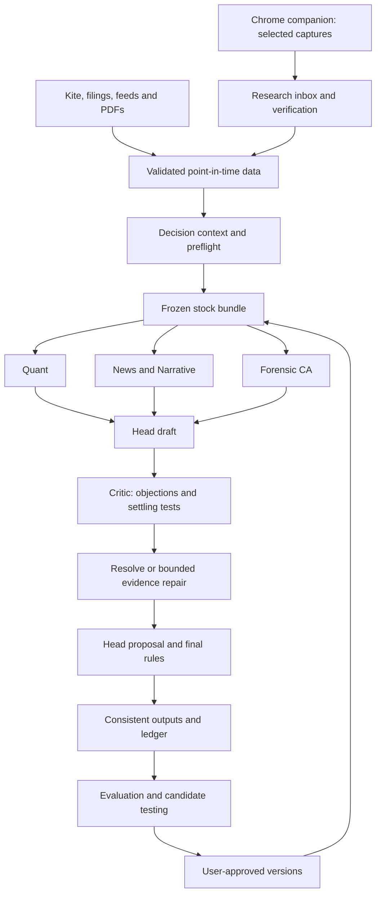
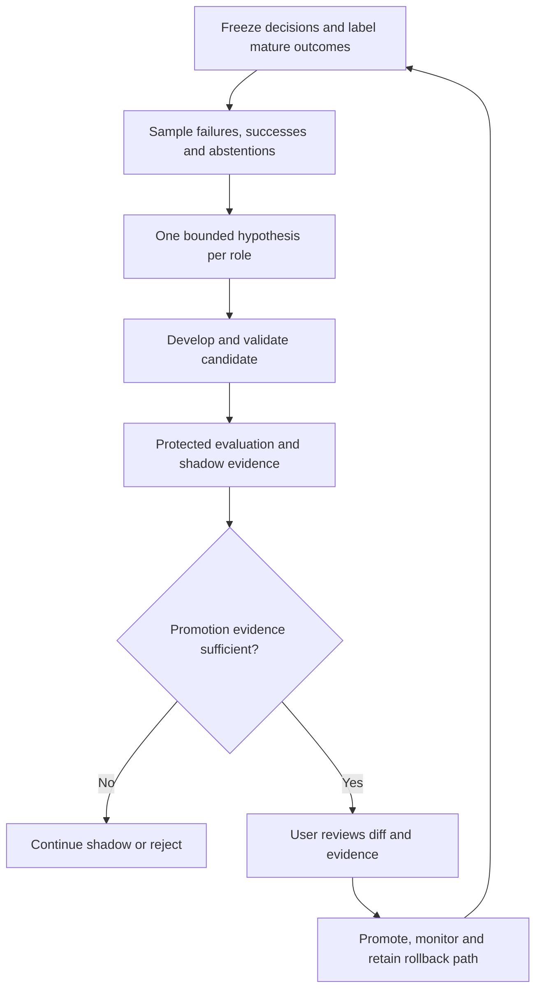
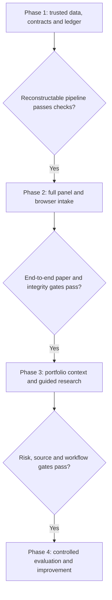

# Personal CA Platform — Final Consolidated Design

**Owner:** Gaurav Bhardwaj  
**Original design:** 7 November 2026  
**Consolidated revision:** 2.0 · 15 November 2026 · Asia/Kolkata  
**Purpose:** Personal Indian-equity research, decision support and portfolio intelligence  
**Status:** Accepted design consolidated for implementation. This is not a claim that the full platform has been built or that its investment performance has been established.

## Document authority and preservation

The main body is the current specification. It integrates the original expert design, all refinements accepted in the review, and the Chrome research companion integration. The original design is preserved **verbatim at the end**, including its examples, numerical policies and embedded-content placeholders. Historical statements in that appendix do not override the current specification.

No original section has been silently removed. Where an earlier policy was refined or replaced, the original remains available in the preservation appendix and the change is recorded in the refinement register. Unchanged capabilities, scripts, operating modes, checklists, outputs and lessons carry forward. Existing thresholds are initial personal policy choices, not empirically proven investment truths.

The source Markdown contained placeholders for three embedded visuals rather than the visuals themselves. The current body supplies new diagrams and an explicit roadmap; it does not claim to reproduce missing source images.

**Reading order:** goals and requirements → architecture → data and browser intake → analyst panel → rules and contracts → execution → evaluation and ledger → implementation and controls. The original appendix is reference material, not a second active specification.


## Contents

1. Document authority and preservation
2. Summary, goals and non-goals
3. Background: what the india-stock-analyst skill already does
4. Requirements
5. Architecture overview
6. Data layer
7. Browser research companion and project integration
8. Analyst brains
9. Rules engine
10. Critic CA and Head CA
11. Contracts
12. Orchestration
13. Evals and loop engineering
14. Ledger, scorecards and backtesting
15. Laptop setup, tech stack and repo layout
16. Security, secrets and compliance
17. Cost and performance budget
18. Roadmap and phases
19. Risks and open questions
20. Appendix: lessons from the TCS trial and glossary
21. Refinement register and implementation acceptance
22. Reference sources and verification boundaries

The verbatim original follows the current specification as a preservation appendix.

## Summary, goals and non-goals

Build a personal investment research platform on a laptop that works like a panel of chartered accountants. Three independently executed specialist brains (Claude, Gemini, ChatGPT as initial vendor assignments) study each stock using different methods and role-specific views of the same frozen evidence boundary. Independence means no cross-report exposure before synthesis; it does not imply independent statistical errors. A Critic CA attacks the draft verdict, and a Head CA gives the final call. Code owns numerical calculations, hard-rule enforcement, sizing and tax computations. Models propose explicitly recorded assumptions and interpret evidence; code calculates their consequences. Model-generated assumptions and scores are not treated as measured facts.

The platform grows out of the existing india-stock-analyst skill. Its scripts become the data layer and the first brain's tools, almost unchanged.

**Goals**

1. **Test whether the panel improves decisions.** Compare the panel against a strong single-model analyst using the same evidence and deterministic rules, and a predefined screening-and-allocation baseline. Multi-brain superiority is a hypothesis to demonstrate, not an architectural entitlement.
2. **Every verdict is traceable.** Material claims link to timestamped evidence and specific passages. Reconstruct the exact issued decision from stored records; fresh model re-execution may differ.
3. **Measured, not assumed.** Evaluate evidence/process quality, explicit forecasts and investment performance separately. Use the configured Nifty 50 ETF total-return comparison for investment outcomes; evaluate specialists against their remits.
4. **Self-improving under control.** An eval loop proposes prompt and weight changes; only changes that beat the current version on held-out data ship.
5. **Plain language.** Short answers, one-line reasons, two concepts taught per run, WhatsApp-ready output.
6. **Cheap and local.** Runs on a personal laptop, nightly batch plus on-demand runs, within a fixed monthly API budget.
7. **Abstention is a valid result.** Pick counts are maximums, never quotas. Return fewer candidates or none when requirements fail. Distinguish avoid, wait, insufficient data and no eligible recommendation.
8. **Separate investment merit from portfolio suitability.** Evaluate the stock at its current price and horizon, then evaluate the proposed action against existing exposure, available investment capital, liquidity needs and the user's configured constraints. Missing personal context limits the output to research, not a personalised allocation.

**Non-goals (for now)**

- No order placement. Kite access stays read-only; the user places trades by hand.
- No intraday, F&O or leverage.
- No advice or distribution to others in current scope. Any future sharing or advisory business requires a separate legal/compliance assessment of the applicable SEBI framework and permissions; the document is not a legal determination.
- No access-control bypass, cookie export or unattended login automation. User-authorised capture of already rendered browser content is an input path, subject to source usage rights. ET PDFs remain a fallback. Subscription access and permission for extraction, AI processing or retention are recorded separately.
- No custom model training. Improvement comes from prompts, weights, rules and data, measured by evals.

## Background: what the india-stock-analyst skill already does

The skill is a working single-brain analyst in the open SKILL.md format. It runs in Claude Code and Gemini CLI with Kite MCP connected, and every script is plain Python.

**Modes**

| Mode | Trigger | Output |
| --- | --- | --- |
| A. Single stock | "analyse TCS" | Short and long-term verdict, one-stock report |
| B. Recommendations | "best 4-5 stocks for 6 months" | Ranked picks, allocation, report, ledger entry |
| C. Hot stocks by cap | "hot stocks small mid large" | 2-3 picks per bucket per horizon |
| D. Replan | "only X and Y, replan Rs 2 lakh" | New split, same core |
| E. Track record | "how did past picks do" | Each pick vs Nifty 50, by pattern vs no pattern |

**Pipeline (Modes B and C)**

1. Universe: Nifty 500 bucketed by rank (large 1-100, mid 101-250, small 251-500); ASM/GSM surveillance stocks removed.
2. Screen: a Screener.in export, or without it the NSE bhavcopy screen plus a fresh-breakout pattern scan.
3. Idea signals: permitted ET Prime browser captures or PDFs, NSE/BSE announcements and news. Signals guide investigation and may add rubric-defined score; they never override failed gates.
4. Deep dive on about 15 stocks: one year of Kite candles, indicators, candlestick and chart patterns, fundamentals and shareholding with cross-checks.
5. Rank and pick up to 4–5 eligible candidates, with actionable plans only where supported. Record entry conditions, relevant stop controls, distinct valuation/technical targets, horizon and code-calculated scenario returns after estimated costs and tax. Apply the benchmark gate on stated assumptions; return none when no candidate qualifies.
6. Allocate core (index ETF) plus satellite (stocks).
7. Report (one HTML with tabs and candlestick charts), log to the ledger, teach two concepts.

**Scripts that carry over to the platform**

| Script | What it does | Platform role |
| --- | --- | --- |
| technicals.py | SMA 20/50/200, RSI, MACD, ATR, 52-week range, candlestick patterns with trend context, support/resistance zones | Feature builder in the data layer |
| chart\_patterns.py | Double bottom/top, (inverse) head and shoulders, wedges, triangles; status, breakout volume, measured-move target, stop, quality; 20-day volume bias; bhavcopy scan | Feature builder + Quant brain tool |
| bhav\_screen.py | Incremental NSE bhavcopy download, holiday-safe; short-term gates; split/bonus flag | Ingestion job + screener |
| allocate.py | Core-satellite split, score/risk weights, stock and sector caps, floor, whole shares, max-loss check, subset replan | Rules engine |
| build\_report.py | Self-contained HTML report, dark mode, SVG candlesticks with pattern overlays | Report renderer |
| track.py | Logs picks; reviews returns vs Nifty, targets, stops, pattern vs no pattern | Seed of the ledger |

**References that become platform policy**

- data-sources.md: source hierarchy, the six cross-check rules, bhavcopy format, Nifty P/E staggering rule.
- screening.md: gates per horizon, score weights, expected-return and stop method.
- allocation.md and whatsapp-format.md: sizing, caps, tranche prices (T1/T2/T3), and the initial 2% planned-loss-at-stop policy per stock. The consolidated risk controls supersede any description of this as a guaranteed maximum loss.
- patterns.md: meaning of each chart pattern, when to use it, confirmation checklist.
- concepts.md: the four-level concept bank for the Learn section.

**Limits the platform must fix**

- One model's judgment only; no independent check.
- Numbers gathered inside the conversation, so two runs can disagree.
- No point-in-time store, so no honest backtest.
- Track record is a CSV with no per-brain or per-prompt scoring.
- Improvements are manual edits with no regression test.

## Requirements

**Functional**

| ID | Requirement |
| --- | --- |
| F1 | Analyse one stock on demand across explicitly configured short, medium and long horizons. Actionable purchases require supported entry conditions, scenario/target ranges, relevant stop controls and code-calculated after-tax scenario returns; other decisions explain why no trade plan is issued. |
| F2 | Recommend up to 4–5 eligible stocks for a chosen horizon, with a one-line reason each; zero picks is valid. |
| F3 | Discover hot-stock candidates per cap bucket (large, mid, small) for short and long term; counts are upper bounds and momentum is not investment eligibility. |
| F4 | Promoter list and holdings, pledge, FII/DII/MF trend, insider trades. |
| F5 | Explain material news/filings, what changed versus documented expectations, and a qualified priced-in hypothesis or an explicit inability to establish one. |
| F6 | Index-ETF core plus stock-satellite allocation and subset replan, accounting for existing holdings, capital, liquidity needs and horizon. Never relax hard limits merely to fill slots. |
| F7 | Chart and candlestick patterns with meaning, status and trade plan. |
| F8 | Accept permitted browser-companion captures and user-provided ET Prime PDFs as attributed, unverified idea signals; retain source access and processing-rights status. |
| F9 | Portfolio sync from Kite holdings; warnings on held stocks (bearish patterns, stops, governance flags). |
| F10 | Tax view: STCG vs LTCG, holding-period timing, loss harvesting candidates. |
| F11 | Outputs: chat summary, HTML report, WhatsApp text; Learn section with two new concepts each run. |
| F12 | Track every verdict against the configured Nifty 50 ETF comparison, per panel/model/prompt/rule version; evaluate brains by role and incremental contribution. |
| F13 | Browser research inbox: accept selected captures with idempotent receipts, versions, passage references, company resolution and verification tasks. |
| F14 | Distinguish research-only, actionable purchase, wait, avoid, insufficient data and existing-position actions. Preserve material dissent and unresolved blockers. |
| F15 | Preserve proposal, criticism, resolution tests, rule adjustments and final permitted action as separate records. |
| F16 | Support bounded evidence inspection/repair, resumable execution and an evaluation contract frozen when a decision is issued. |

**Non-functional**

| ID | Requirement | Target |
| --- | --- | --- |
| N1 | Reconstruction and re-execution | Exact historical reconstruction from stored requests/responses, tool results and versions; fresh model calls may differ |
| N2 | Traceability | Source/locator, passage, public-availability timestamp, first-seen/ingestion timestamps, accounting context, source version and provenance chain |
| N3 | Independence | Brains never see each other's output before the Head CA |
| N4 | Vendor neutrality | Config-driven adapters, subject to role compatibility, evaluation and vendor-separation constraints |
| N5 | Latency | Single stock under 3 minutes; nightly batch of 15 stocks under 45 minutes |
| N6 | Cost | Fixed monthly cap enforced in code; run stops cleanly at the cap |
| N7 | Safety | Read-only Kite; no secrets in prompts, logs or reports |
| N8 | Role-aware robustness | Continue available research and holding alerts; block new actionable buys if a required assessment is missing. A current compatible prior assessment may be reused only after validity checks |
| N9 | Language | Chat reply under about 250 words plus the picks table; plain words |
| N10 | Portability | Core runs on macOS, Linux or Windows (WSL); Chrome companion is a separate desktop extension. External dependencies are declared APIs/data services and permitted source access |
| N11 | Resilience | Checkpoint stages, dependency-aware invalidation, idempotent writes and explicit partial-run status |
| N12 | Information boundary | Finish discovery before bundle freeze; version later material evidence and reassess affected conclusions |
| N13 | Semantic validity | Validate units, periods, calculations, decision-specific fields and blocker resolution, separately from schema shape |
| N14 | Intake security | Loopback-only authenticated service, configured extension origin, bounded payloads, no credential export, explicit selected-source transmission |

## Architecture overview

Facts enter through code-controlled adapters and a browser research inbox. Models interpret a shared, frozen evidence boundary independently. The Head proposes; the Critic tests; code enforces the permitted implementation. Outcomes feed evaluation, not automatic untested policy changes.



The feedback arrow represents promotion of tested prompt/model/policy versions for **future** runs; it never modifies historical decisions. Evidence repair is limited to one pass and can create a new bundle; it is not an open-ended debate.

**End-to-end run for one stock**

1. Establish decision timestamp, horizon, mode and action; capture portfolio context and applicable hard constraints.
2. Run an initial preflight for data availability and known exclusions. Complete permitted discovery, article/filing retrieval and material-claim verification. Re-run eligibility checks on the resulting evidence.
3. Freeze a versioned point-in-time bundle. Missing material evidence blocks an actionable purchase but can still permit explanatory research.
4. Run Quant, News and Forensic independently against this boundary. Role-specific views retain access to relevant source passages; no brain sees another report.
5. Validate structure and semantics. Hide vendor identities using recorded random A/B/C labels while retaining specialist remit and provenance.
6. Head drafts a conditional investment decision, scenarios, assumptions, entry conditions and invalidation triggers.
7. Critic performs the required review checklist and returns **zero to seven supported material objections**, not an obligatory quota. Record settling tests.
8. Head responds accept/reject/defer. Factual/numerical blockers require recorded passed/failed/unresolved tests. Permit one bounded repair through the data layer; version evidence and reassess affected reports. Unresolved material blockers prevent new buys.
9. Head finalises its proposal. Rules apply eligibility, existing-position exposure, sizing, tranches, portfolio risk and scenario-based tax calculations.
10. Validate the whole final plan. Render its actual permitted action, with explicit rule adjustments and unresolved limitations.
11. Store the bundle, requests, responses, stage transitions, proposal, criticism, tests, final action and evaluation contract.
12. Label mature outcomes under the frozen evaluation policy. Diagnose process/forecast/performance separately; only evaluated and approved changes affect future runs.

**Research versus action:** an excluded stock can still receive research explaining the exclusion. A browser comparison is a research answer, not a completed panel verdict. A purchase requires all applicable production gates.

## Data layer

The data layer is code-controlled. It ingests, normalises, validates and versions facts and sources. Upstream model-assisted article/filing extraction produces attributed claims, not verified numbers by fiat; validation and derived calculations remain in code. Analysts read frozen bundles and never independently fetch prices or ratios.

**Sources and ingestion jobs**

| Dataset | Primary source | Fallback | Job and cadence |
| --- | --- | --- | --- |
| Daily OHLCV, LTP | Kite MCP / Kite Connect | NSE bhavcopy | `ingest_prices` nightly after 7 pm IST; LTP on demand |
| Full bhavcopy with delivery % | nsearchives.nseindia.com sec\_bhavdata\_full | none | `ingest_bhav` nightly, incremental, holiday-safe |
| Index levels, P/E, P/B, yield | niftyindices.com historical data | NSE index archive | `ingest_index` nightly |
| Universe and buckets | Nifty 100 / Midcap 150 / Smallcap 250 lists; AMFI half-yearly list | none | `ingest_universe` monthly and on index review |
| Surveillance | NSE ASM/GSM lists | none | `ingest_surveillance` daily |
| Quarterly results, annual reports | NSE/BSE filings (XBRL, PDF) | Screener.in export | `ingest_filings` daily, new filings only |
| Shareholding pattern | NSE/BSE quarterly filing | Screener / Trendlyne | `ingest_shareholding` after each quarter |
| Insider trades, pledges | NSE/BSE SAST and PIT disclosures | none | `ingest_insider` daily |
| Corporate announcements | NSE/BSE announcements | ET Markets RSS | `ingest_announcements` every 2 hours on market days |
| Corporate actions | NSE/BSE corporate actions | Kite adjusted candles | `ingest_actions` daily; drives price adjustment |
| News | Search-grounded discovery and permitted RSS feeds | Manual source input | Retrieved, snapshotted and validated before bundle freeze; material late discoveries use repair |
| Browser article captures | Chrome research companion | JSON export/import | Explicit user send into research inbox; validate rights, access warnings, passage references and company identity |
| ET Prime PDFs | User drops permitted file into `inbox/et/` | Browser capture where permitted | `ingest_pdf` on arrival; same provenance and usage checks as other research |
| Holdings | Kite holdings through read-operation allowlist | Manual CSV | `ingest_holdings` on demand |
| Transaction/tax lots | User-provided broker transaction and tax exports | Manual verified ledger | `ingest_transactions` on demand; holdings average price is not a lot history |
| Tax rates | Official budget notes / Income Tax site | none | `tax_rates.yaml`, updated by hand after each budget |

Exchange endpoints and formats can change. Prefer documented/permitted endpoints and archives, identify the client appropriately, respect current limits, back off on errors and cache downloads. Do not evade access controls or assume an archive is always available. Record source revisions; a corrected document may require a new version even when its URL is unchanged.

**Storage**

- **DuckDB** file `data/market.duckdb` for tables; Parquet files for raw candles and bhavcopy; raw PDFs and HTML kept under `data/raw/` with SHA-256 hashes.
- Core tables: `prices_daily`, `bhav_daily`, `corp_actions`, `fundamentals_q`, `shareholding_q`, `insider_trades`, `announcements`, `news_items`, `et_recos`, `index_valuation`, `universe`, `surveillance`, `holdings`.
- Each record carries source identity/locator, record version, content hash where retention permits, `period_end`, `published_at`, `first_seen_at` and `ingested_at`. Use timezone-aware timestamps. `as_of` remains a compatibility field with explicitly defined semantics, never a substitute for the separate timestamps.
- `published_at` is the public availability time of this exact version; `first_seen_at` is the first time this platform obtained it; `ingested_at` is this stored record's creation time. Unknown publication time stays unknown and cannot be backfilled as a verified historical fact.
- Add `research_sources`, `source_passages`, `source_versions`, `research_claims`, `claim_company_links`, `verification_tasks`, `transaction_lots`, `tax_context` and `source_usage_policies`.
- A source URL is not evidence independence: preserve `derived_from`/syndication relationships so a filing and articles copying it are not counted as independent confirmations.

**Point-in-time rule**

A bundle uses a precise decision timestamp, not only a date. Information released after market close cannot influence a decision made that morning. Results filed on 8 October are invisible to a 7 October bundle, even when re-run in December. Restated numbers create a new version; old versions are retained subject to rights and retention policy.

Two modes must never be confused:

| Mode | Eligibility and meaning |
| --- | --- |
| Public-information reconstruction | Include only versions verifiably public by the decision timestamp. Later collection is allowed only when original publication timing and content version can be established. Label this as reconstruction, not actual system knowledge. |
| Actual-system reconstruction | Recover the exact stored bundle and outputs actually used, including first-seen and run timestamps. Do not silently insert later-collected material. |

Exclude publication-time-uncertain evidence from historical decisions that depend on its availability. Historical universe membership, surveillance status, feature code, corporate actions and source revisions must also be point-in-time. LLM contamination and execution assumptions remain separate limitations; timestamp filtering alone does not establish an honest skill backtest.

**Price adjustment**

Raw bhavcopy is stored unadjusted. Store versioned technical adjustment series and the corporate-action inputs used. Apply appropriate price **and volume** transformations for supported splits/bonuses; historical features must use action treatment applicable at their decision timestamp, not today's silently revised series.

Keep technical adjustment, traded-price execution and investment total return separate. Return accounting includes dividends, cash distributions and security entitlements where applicable. Rights issues, mergers and demergers need explicit event-specific treatment; do not model every event as a split. Unsupported or unresolved actions flag affected features/performance and prevent dependent actionable conclusions. Provider-adjusted candles must be labelled with their basis and must not be adjusted twice.

**Cross-check rules (from the skill, enforced in code)**

1. Price, 52-week range and moving averages come only from Kite or bhavcopy candles. Any aggregator price more than 2% off is ignored and logged.
2. Profit means net profit attributable to shareholders from the filing, never total profit including minority interest.
3. Growth is computed excluding exceptional items; both headline and underlying growth are stored.
4. Shareholding is parsed from the raw filed pattern into fixed categories: promoter, FPI, mutual funds, insurance, other DII, retail, others.
5. Every figure has an availability timestamp and reporting period. Retain the initial 100-day quarterly freshness threshold as versioned policy, with its clock basis explicit (publication time for retrieval freshness; reporting period and expected release schedule shown separately). Do not confuse an old annual note with a missing newly due quarterly filing.
6. A verified authoritative filing can establish a reported fact without an aggregator. Aggregators corroborate and detect discrepancies; they may copy the filing and are not necessarily independent evidence. Match metric definition, reporting period, scope and units before comparing. Retain the initial 5% numerical-discrepancy flag after normalisation; authoritative-source priority does not itself resolve a material semantic conflict. Missing corroboration is distinct from an unresolved material conflict.

**Financial fact context and validation**

A numeric financial record includes metric definition, consolidated/standalone scope, quarter/YTD/full-year/TTM period, currency/unit, reported/adjusted status, original/restated source version and exact source location. Growth, ratios and exceptional-item adjustments reference their component inputs and formula/code versions. Standalone and consolidated profits are distinct facts, not automatically a source conflict. Preserve reported values; analyst interpretation of an adjustment remains explicit rather than silently replacing a filing figure.

Apply statement reconciliation and arithmetic checks where meaningful. Store data availability/coverage separately from numerical values: `available`, `missing`, `not_applicable`, `conflicted`, `stale`. Zero is a genuine value, never an unknown-data sentinel.

**Feature store**

Nightly jobs compute features per stock and date: the outputs of technicals.py and chart\_patterns.py, ratios (P/E, P/B, ROE, ROA, debt/equity, OCF/profit), growth rates, promoter and pledge trends, delivery % trends, sector relative strength vs Nifty 50 over 3 and 6 months. Features are stored with the code version that made them.

**Bundle builder**

`build_bundle(symbol, as_of)` assembles one JSON per stock: identity, features, latest filings summary, shareholding table, insider trades, announcements, news, ET view, holdings position, data-quality flags. Its canonical content hash identifies the evidence boundary. Each model request has its own complete-request hash; the bundle hash alone is insufficient to cache Head/Critic calls. Include decision context, horizon definitions, relevant raw evidence locators, source-policy/retention limitations, feature versions, action-adjustment versions, assumptions and quality coverage.

## Browser research companion and project integration

### Responsibility and implementation status

The Chrome companion is the platform's research intake, not a second investment engine. Keep the working extension and retire the standalone simulated website as an implementation dependency. Browser research questions can remain lightweight, clearly labelled research answers; investment recommendations still require the platform panel and rules.

| Capability | Status as of 15 November 2026 |
| --- | --- |
| Chrome Manifest V3 side panel, rendered-article/selection capture, passage inspection/search, selected-source export and manual link opening | Implemented in extension 0.1.1 |
| Explicit ET main-host permission button | Implemented after the initial activeTab permission failure |
| Capture in the user's signed-in Chrome | User reported “yeah its working” after the permission fix; completeness, table fidelity and cross-article accuracy are not yet established |
| Optional OpenAI local bridge | Included; validation/authentication tested with fixtures/stubbed provider. No live AI response or end-to-end platform integration has been confirmed in this session |
| Direct “Send to Personal CA”, persistent inbox and ingestion receipt | Planned integration, not shipped in 0.1.1 |
| Semantic link prioritisation and bounded multi-hop exploration | Planned; current links are ordinary extracted links opened manually |
| Full platform, multi-vendor panel and investment-performance claims | Design targets, not established by the extension test |

The source package is [Personal_CA_Chrome_Extension.zip](https://chatgpt.com/library?file_id=libfile_e14d82bd7cec8191be52d500ef3e0538&account_id=personal), version 0.1.1. Its README contains laptop installation and optional bridge setup. Preserve its source and test history when moving it into the project.

For the current laptop test: extract the ZIP, open `chrome://extensions`, enable Developer mode, load the included `extension` folder, open the signed-in article and click the toolbar icon. Use **Allow ET Prime & capture** to approve site access, then inspect the captured passages. For a noisy result, use **Capture selection**. API-free capture/search works independently of the optional AI bridge. The prototype bridge is started with `python3 bridge.py` (or the documented Windows equivalent), accepts the extension ID/API key/model through local terminal prompts and supplies a pairing token. Do not place API keys in the browser or document. These are existing prototype instructions, not evidence that the main platform service is already connected.

### Current browser behaviour

1. The user signs into ET in their own Chrome profile. No session transfer from another browser is assumed.
2. Clicking the toolbar icon can grant temporary `activeTab` access. Opening a generic side panel alone is not sufficient.
3. **Allow ET Prime & capture** requests optional access specifically to `https://economictimes.indiatimes.com/*`; it is not all-sites access. The grant may persist and can be revoked in Chrome's extension Site access settings. Other hosts, such as a different mobile domain, need their own authorised access path.
4. Capture inspects rendered DOM text or the user's selected text. It does not recover article bodies from hidden application JSON, export cookies, intercept credentials, remove paywalls or solve challenges.
5. Article selectors are heuristics; fallback body captures may include unrelated content. Every capture remains `capture_unverified`; inspect final paragraphs and tables against the page. A successful capture is not proof of full access.
6. Source text and passage references are shown before any model call. Links open only on an explicit click; capturing the new tab is a separate operation.
7. Current session limit is ten sources; per-source text cap is 80,000 characters with truncation warning. Current AI requests reject more than 120,000 selected text characters rather than silently clipping.
8. Captures use Chrome session storage, clearing on browser restart/extension reload. Exports and clipboard copies survive separately. Clearing a session does not retract an earlier export or API submission.

### Target local-service boundary

Evolve the prototype bridge into a loopback-only service with distinct ingestion, research-Q&A and orchestration responsibilities. The extension sends selected sources explicitly; it does not own model-vendor routing or independently call three brains.

| Proposed interface | Responsibility |
| --- | --- |
| `POST /v1/research/captures` | Validate and enqueue a selected-source batch; return per-item accepted/duplicate/rejected receipts |
| `GET /v1/research/receipts/{id}` | Return ingestion/verification status without exposing secrets |
| `POST /v1/research/questions` | Answer against selected eligible captures, labelled research-only; no implicit panel verdict |
| `POST /v1/analysis/jobs` | Explicitly request a stock analysis using eligible source IDs plus current data |
| `GET /v1/analysis/jobs/{id}` | Report stage status, result references and limitations |

These are proposed platform interfaces, not endpoints already present in 0.1.1. The prototype exposes only its own `/health` and `/ask` bridge paths. Keep JSON export/import as a supported fallback.

Bind to `127.0.0.1`, require a paired extension origin and random session token, bound request sizes, validate host/origin and reject unapproved operations. Keep API keys in the OS keychain in the platform; the prototype currently retains its key in the terminal process. A localhost URL alone is not authentication. Do not log full articles or questions in routine server logs. Preserve necessary evidence in the governed evidence store, subject to permitted retention.

### Capture, research and fact contracts

Transport envelope fields include `schema_version`, `capture_id`, `research_session_id`, source URL/canonical identity, title, author, publication/update time if known, `captured_at`, extension version, extraction method, passage IDs/text, access warnings, truncation flag, source content fingerprint, related links and parent-link selection rationale when available. Unknown fields remain null; publication time is not inferred from capture time.

The backend computes its own payload fingerprint, validates every field, strips credentials/tracking where safe without changing source identity, bounds strings and accepts only supported URL schemes. Browser tab IDs are session-local, not durable evidence IDs. Server ingestion adds `first_seen_at`, `ingested_at`, stable source/version IDs and usage-policy status. A repeated equivalent payload is idempotent; changed source content produces a new version, never an overwrite.

Access and usage are separate dimensions:

- Access: `capture_unverified`, `partially_read`, `fully_read` only with stated review basis, or `inaccessible`. A user completeness check can be recorded but is not independent verification.
- Usage: permitted processing/retention scope, basis, review date and unresolved restrictions. Successful browser capture or a paid subscription does not grant extraction/AI/archival rights.
- Evidence: publisher observation, opinion, third-party forecast, platform assumption, derived calculation or independently verified fact. No article claim becomes verified merely by import.

### Research inbox and verification

1. Validate the batch and return a receipt before running expensive analysis.
2. Deduplicate exact and syndicated content and preserve provenance. Repeated coverage is not repeated confirmation.
3. Extract company-linked claims, recommendation direction, original reference price, target, horizon, broker/author, thesis, catalysts, risks and source passages. Missing values stay null.
4. Resolve company names to exchange/symbol/ISIN where supported. A multi-stock article creates separate claim-to-company links. Ambiguous matches remain unresolved and cannot silently attach to a stock.
5. Turn material claims into verification tasks: order win → official disclosure and conditions; profit growth → comparable filing inputs and code; broker target → attributed opinion, not our valuation.
6. Retrieve both supporting and contradictory official evidence. Store verification result, source references, timestamp and unresolved limitations.
7. Join eligible research with Kite prices/features, filings, ownership and portfolio context. Freeze the bundle before independent analyst execution.

### Guided exploration

Start from user-selected pages or section URLs. The planned research queue prioritises relevance to holdings/watchlists/sectors, new material evidence, missing thesis inputs, contradictory findings and links to original sources. Headline upside is not a ranking objective.

Default future discovery budget: up to 20 article pages per session and two article-to-article hops, with explicit visited URLs, selection reasons and remaining budget. Track official-document retrieval separately with its own bounded budget so it cannot become an unlimited side channel. Existing 0.1.1 capture limits remain in force until deliberately upgraded; a future twenty-page discovery budget does not mean twenty captures are already supported.

Navigate visibly and sequentially, allow cancellation, record partial/inaccessible pages and stop at access challenges. Do not infer full text from snippets. ET-specific automation/AI processing requires an appropriate permission basis; this restriction is not resolved by the successful capture test. PDFs are fallback inputs subject to the same rights checks, not a way around them.

### First integration acceptance test

One selected article → ingestion receipt → company resolution → one material claim verified against an official filing → joined Kite data → frozen bundle → panel proposal → Critic resolution → final rule-enforced action → ledger trace back to the captured passage. Include duplicate submission, partial capture, ambiguous company, revoked site permission and missing usage rights as negative cases. Only after this path works should guided exploration be promoted.

The browser assistant may compare articles independently, but must state that it has not completed Quant/Forensic review. No live stock verdict is inferred from the earlier simulated demo.

## Analyst brains

Brains are split by job, not by vendor, and each job runs on a different vendor. Each brain gets a role-specific view of the same frozen bundle, works alone, and returns one Brain Report (see Contracts). Different vendors are a diversity mechanism, not proof of independent errors. Model choices below are starting points; the eval loop picks the winner per role.

| Brain | Default model | Question it answers | Unique inputs | Method |
| --- | --- | --- | --- | --- |
| Quant | Claude | Is valuation attractive, and under what entry conditions? | Feature store, financial inputs, valuation scenarios, chart patterns, sector strength | Skill gates, fundamental valuation assumptions, technical structure, code-calculated scenario returns |
| News & Narrative | Gemini | What changed versus expectations, and what could change next? | Frozen announcements, permitted article captures/PDFs, search evidence, concall transcripts and annual reports | Event materiality, operating-assumption challenge, catalyst timing, qualified priced-in hypothesis |
| Forensic CA | ChatGPT | Can the numbers be trusted? | Full filings: notes, cash flow, related-party transactions, auditor report, pledges, insider trades | Accounting red-flag checklist and governance score |

**Brain 1: Quant (Claude)**

- Reuses the skill end to end: gates from screening.md, score weights per horizon, chart\_patterns.py and technicals.py outputs, expected-return range, stop, reward/risk.
- Tools: read-only access to frozen features, valuation calculation service and pattern scan; no independent web retrieval. A calculation tool can evaluate recorded assumptions without expanding the evidence boundary.
- State gates and pattern status; distinguish technical measured-move targets from fundamental valuation ranges. Do not copy a publisher target into our valuation without analysis.
- Own the explicit valuation method, its suitability for the business, operating drivers, valuation inputs, horizon, bear/base/bull assumptions and what the current price requires to be true. Choose context-appropriate methods rather than imposing a single multiple on every sector.
- Models propose assumptions; numerical valuation, reward/risk and return calculations run through code and return calculation references. News challenges operating assumptions; Forensic challenges financial-input reliability; Head reconciles them.
- Show scenario-based after-tax return ranges only where tax inputs are sufficient. A range is not a probability-weighted expected return unless scenario probabilities are separately defined and justified. Avoid false numerical certainty.
- Fails safe: if candles are missing or a split flag is unresolved, stance is "insufficient data".

**Brain 2: News & Narrative (Gemini)**

- Strengths used: long context (whole annual reports and concall transcripts in one call), PDF reading, Google Search grounding through the API.
- Steps: use 90 days as the default discovery window; retain older events while their implications remain unresolved. Tag results, order win, guidance, management change, regulatory, litigation, block deal and rating change; judge materiality, direction and timing. A post-event price move alone does not establish that an event is fully priced in.
- ET Prime: extracts recommendation, target, horizon, broker, date; reports agreement or disagreement with the evidence.
- Rules: news needs a source URL or a resolvable supplied-file locator. Rumours are labelled and cannot drive a purchase. For a priced-in hypothesis, connect documented prior expectations, the new information, plausible business impact, benchmark/sector-relative reaction and what current valuation requires. If these are unavailable, state “cannot establish whether priced in.”
- Browser captures are permitted research inputs where usage rights allow. Their acquisition is upstream of the analyst, not live browsing inside the frozen run. Preserve permitted passages and source versions; record reconstruction limitations when full text cannot be retained.

**Brain 3: Forensic CA (ChatGPT)**

- The "CA" core. Checks use pass / watch / fail / not_applicable / insufficient_evidence, with applicability, evidence and materiality stated. Code computes ratios and trends; the analyst interprets them:
  1. Operating cash flow vs net profit over 3-5 years (profit not turning into cash).
  2. Receivable days and inventory days trend vs revenue growth.
  3. Other income share of profit; exceptional items frequency.
  4. Related-party transactions as a share of revenue or assets.
  5. Contingent liabilities vs net worth.
  6. Auditor: qualified opinion, emphasis of matter, resignation, frequent changes.
  7. Promoter pledge level and trend; promoter selling; insider trade timing vs results.
  8. Capitalised expenses and capital work-in-progress that never completes.
  9. Dilution: equity issues, ESOP cost, warrants to promoters.
  10. Tax rate far from statutory without explanation.
- Banks and NBFCs use a separate checklist: GNPA/NNPA trend, provision coverage, capital adequacy, slippages, restructured book.
- Retain the governance score 0–100 and initial below-40 veto as policy, but derive the score through a versioned rubric applied to evidence-backed findings. Report evidence coverage separately. Missing auditor evidence is not a clean audit. Explicit severe findings have their own vetoes and cannot be averaged away. An LLM-proposed classification remains a judgment input even when enforcement is deterministic.

**Shared rules for all brains**

- Use only bundle facts and cited sources; never recompute a number the bundle already has.
- Every material claim cites an evidence ID and source passage/locator in the frozen bundle. A naked fetched URL does not expand the boundary; late retrieval uses the repair path.
- State what would change the stance (a falsifiable condition).
- Separate evidence sufficiency/coverage from forecast probability. A probability requires an explicit event, entry convention, horizon and outcome rule. “The stance is right” is not an evaluable event. Probabilities stay labelled uncalibrated until demonstrated otherwise and are not established sizing inputs.
- Specialist conclusions are primary: Quant reports valuation/setup; News reports developments/catalyst uncertainty; Forensic reports reliability/governance. Optional overall stances are secondary and must specify horizon/rationale. A clean forensic assessment is not a buy vote.
- Separate observations → interpretations → assumptions → conclusions. Material numerical claims reference code calculations or authoritative records, never unsupported arithmetic in prose.
- No brain sees another brain's report.

**Adding a brain later**

A new brain must bring new information or a new method, not another opinion on the same data. It runs in shadow mode (logged, not shown to the Head) for at least the original 30-verdict observation floor and joins only when mature, dependence-aware evaluation and ablation demonstrate contribution. Thirty correlated or unresolved calls are not sufficient promotion evidence.

## Rules engine

The rules engine is deterministic Python used both before judgment (preflight) and after the Head's proposal (final enforcement). Rules live in versioned `config/rules.yaml`; no prompt overrides them. Research eligibility and purchase eligibility are separate. Re-check portfolio and price-dependent constraints near issuance; materially changed inputs require reassessment rather than a silently stale plan.

### Hard vetoes for new purchases and additions

Retain the original numerical thresholds as initial personal policy choices pending evaluation. A veto removes the actionable purchase, not the stock's research history or monitoring obligations.

| Rule | Initial policy and interpretation |
| --- | --- |
| Surveillance | Stock on the applicable NSE ASM or GSM list |
| Pledge | Above 10% of promoter holding, or rising for two quarters; define the denominator and period comparison explicitly |
| Governance | Below 40 under the versioned evidence-backed governance rubric; coverage failures are separately gated |
| Audit | Qualified opinion or auditor resignation within the last 12 months under initial policy; record exact source, nature and applicability |
| Liquidity | 20-day average traded value below ₹5 crore; ₹10 crore if an explicitly configured microcap classification applies |
| Reward/risk | Below 2 for short-term purchases; stop and target inputs must first pass validity checks |
| Benchmark | The defined after-tax return assumption does not beat the configured Nifty 50 ETF assumption over the same horizon; show sensitivity and uncertainty rather than claiming assured outperformance |
| Data quality | A decision-driving material conflict is unresolved; missing aggregator corroboration alone is not a conflict |
| Stale data | Price older than one trading day, or required quarterly data outside the initial 100-day freshness policy without an acceptable newer filing; define timestamp and release-schedule semantics |
| Bearish pattern | Confirmed bearish chart pattern on a short-term buy candidate |
| Required evidence | A required assessment or material settling test is missing/unresolved; no new buy based on an arbitrary confidence haircut |

The universe currently starts at Nifty 500. Microcaps outside that universe are not silently added; the original microcap liquidity threshold remains defined for any explicitly expanded future universe.

### Action-specific handling

| Action | Enforcement |
| --- | --- |
| New purchase | Evidence, valuation/entry, liquidity, concentration and risk eligibility |
| Additional purchase | All purchase gates against the resulting total position, including existing lots/exposure |
| Continue holding | Thesis validity, changed evidence, current exposure and monitoring status; a failed new-buy gate is not automatically a sell order |
| Reduce/exit | Evidence-backed trigger, urgency, relevant execution constraints and approximate tax consequences |

A new governance concern blocks additional purchases and triggers a holding review. Never remove a held stock from alerts because it no longer qualifies for recommendations. No automated order tools are wired in.

### Allocation and sizing

1. Default core remains 50% in the configured index ETF; the user can change the strategic split in `user.yaml`.
2. Preserve score/risk sizing as a baseline candidate, not an unchecked formula. The Head score needs a versioned rubric; code applies the policy. Uncalibrated model confidence is not a proven allocation weight.
3. Validate stop placement against technical structure and volatility. Use a configured minimum risk-distance denominator, cap raw weights and reject invalid levels so a tiny stop distance cannot create an oversized position. Fundamental downside scenarios remain visible alongside stop risk.
4. Retain 30% of satellite per stock, 40% per sector, and the original 8% satellite floor as initial policy. Evaluate both incremental allocation and resulting portfolio exposure. Distinguish the capital being allocated from the configured total portfolio risk base.
5. **Never automatically relax hard caps when fewer candidates remain.** Replan does not fill a fixed quota. Residual money follows the configured core/cash policy; core deployment gates still apply.
6. Retain the 2% of configured total investment capital per-stock **planned loss at stop** ceiling. This is not a maximum possible loss: gaps, liquidity and slippage can exceed it. Add a portfolio-wide planned-loss budget, sector/shared-driver checks and a separately reported stress estimate with explicit adverse execution assumptions. Its numeric limit must be set before production allocation; do not invent a default as accepted policy.
7. Drop blanket “half size on disagreement” and “1–2 votes means no trade.” Resolve material claims/assumptions; unresolved material blockers prevent a buy. Code may apply documented uncertainty sizing only under an explicit evaluated policy, never to compensate for false facts.
8. Retain T1/T2/T3 at 50/30/20, or 60/40 for two tranches, as initial schedules. Every purchase tranche must satisfy the stop relationship and entry conditions. State whether triggers are price-, time- or evidence-based; no automatic averaging after thesis invalidation.
9. Allocate whole shares at a timestamped executable-price assumption, not an unqualified LTP. Recheck floors/caps after rounding. Residuals go to configured core/cash and never exceed available capital.
10. Any discretionary concentration exception requires explicit user authorisation and its own recorded exception. It does not mutate global policy. Non-overrideable integrity/security controls remain non-overrideable.

### Core deployment

Retain the original Nifty 50 P/E staging heuristic: compare with the configured five-year average using April 2021 onward under the original consolidated-earnings rationale; below average, one go or two parts; within 10%, two to three parts; more than 10% above, three monthly parts. Write “about.” Verify the index methodology/data basis before implementing the historical comparison. The heuristic is a policy candidate, not a validated timing edge. Insufficient eligible data means disclose/withhold the heuristic, not fabricate a ratio. Unallocated satellite money does not bypass this deployment schedule or liquidity needs.

### Tax and after-tax scenarios

- `tax_rates.yaml` records effective dates, instrument/taxpayer applicability, official sources, last verified date and review status. Review after budgets **and** other relevant changes. A file modification date alone never proves current law; refuse unsupported calculations, while continuing clearly labelled pre-tax research.
- Use transaction lots, the applicable disposal-order convention, acquisition dates/cost basis, realised gains/losses, available offsets and account-level exemption usage. An average holding price and one purchase date are not sufficient for lot-level tax.
- Apply holding-period classification under the effective policy, including exact date-boundary treatment; do not hard-code an ambiguous “under/above 12 months” gap at the boundary.
- Annual exemptions/offsets belong to the taxpayer context and cannot be independently reused for each pick or tranche. If inputs are incomplete, show conditional scenarios and missing inputs rather than an exact personal tax figure.
- Retain the holding-period timing comparison and pre-31-March loss-harvesting view. Show tax savings from waiting alongside market/thesis risk; leave the decision to the user.
- Compute comparable benchmark outcomes under explicitly stated costs, distributions and tax assumptions. Separate scenario ranges from probabilistic expected returns.
- Label amounts “approx.” The platform is not a tax-filing tool; tax-policy changes require reviewed code/configuration and tests, not prompt tuning.

### Stops, alerts and final consistency

Daily checks on held/recommended stocks include stop breach, target reach, bearish confirmation, governance/pledge/auditor events and thesis-invalidation triggers. Store idempotent alerts and render WhatsApp-format text; actual external delivery requires a configured, explicitly authorised channel and is not implied by text generation.

After enforcement, check decision/eligibility/blockers, price relationships, tranche arithmetic, whole-share allocation, portfolio exposure, tax/scenario assumptions and explanation consistency. Display “Adjusted by rules” with input references. If enforcement invalidates the rationale, mark the proposal not actionable pending reassessment. Render the final action from validated fields; never leave a persuasive buy narrative attached to a blocked plan.

## Critic CA and Head CA

The Head CA starts on Claude; the Critic starts on ChatGPT, alternate Gemini. Keep Head–Critic vendor separation as policy. This is a diversity choice, not a guarantee against shared blind spots. Models are config-selected subject to compatibility and evaluation.

### Protocol per stock

1. **Anonymise vendor identity.** Randomise A/B/C labels and record the mapping. Remove vendor/model branding from panel-visible reports but retain specialist remit and evidence provenance. The ledger retains actual IDs.
2. **Inspect when needed.** Head/Critic receive reports and summary by default, with bounded read-only access to cited passages, tables and code calculation inputs within the frozen bundle. A citation's existence is not proof it supports the claim.
3. **Draft.** Head states the proposed action per horizon, evidence sufficiency, valuation/technical scenarios, operating/valuation assumptions, entry conditions, invalidation conditions, material dissent and portfolio-context limitations.
4. **Critique.** Perform the review checklist for factual accuracy, numerical consistency, source support, valuation assumptions, missing material evidence, portfolio fit and policy compliance. Return zero to seven material numbered objections, each with severity, type, source/calculation references, decision impact and settling test. Do not manufacture objections or propose unrelated stocks.
5. **Respond.** Accept changes, reject with evidence, or defer. Record test result `passed` / `failed` / `unresolved`, references, resolution status and decision effect. A rhetorical reply is not a passed test. An accepted limitation may remain unresolved; acceptance does not permit a purchase when the issue is material.
6. **Repair once if necessary.** Inspect existing evidence first; if new evidence is needed, send a bounded request to the data layer. New material evidence versions the bundle and invalidates affected specialist outputs. Reassess and update the Head response; preserve the entire earlier trail.
7. **Finalise proposal.** One routine critique round, plus the bounded repair path. Unresolved material blockers prevent a new buy; wait, avoid or insufficient data remain valid. Further investigation is a separately budgeted new run.
8. **Enforce and reconcile.** Rules produce the final permitted action and consistency checks. Store the proposal separately from the adjusted action.

### Conflict resolution

| Conflict | Required treatment |
| --- | --- |
| Facts or calculations disagree | Reconcile definitions, source versions and inputs; unresolved material conflicts block dependent purchases |
| Explicit hard rule triggered | Code enforces it; analyst voting cannot override it |
| Forensic watch/fail finding without an automatic veto | Explain evidence, applicability and materiality; do not equate every weak ratio with a severe audit event |
| Operating/valuation assumptions differ | Compare explicit scenarios and determine whether the decision changes |
| Quant attractive; News suggests priced in | Examine expectations and valuation assumptions before deciding buy/wait/avoid; no automatic half-size answer |
| Material new event absent from an existing report’s evidence | Version/reassess affected work; do not combine inconsistent information cutoffs |
| Two specialists agree and one dissents | Preserve and test the dissenting claim; no interchangeable-vote majority rule |
| All agree | Critic, evidence and risk gates still apply; shared provenance may explain agreement |

### Disagreement and confidence

Retain disagreements in the ledger by claim, assumption, materiality and horizon. The original confidence-weighted -2…+2 stance spread and 2.0/3.0 thresholds are preserved in the historical appendix as a baseline experiment, **not an active sizing/veto rule**. Specialists answer different questions; their stance spread is not automatically a measure of decision uncertainty. Test any replacement index before assigning action consequences.

Separate evidence sufficiency from explicit forecast probabilities. A forecast must define its event, horizon, entry/fill convention and scoring rule. Display uncalibrated probabilities honestly; do not manufacture a numerical confidence cap to compensate for missing required evidence.

### Output style

Keep the original picks table first, one-line reasons, ranges not promises, about 250 words plus table, two Learn concepts and the “analysis, not investment advice” line. Do not force a trade-level table when no trade is justified; show the reason, missing evidence or waiting condition. The full HTML report includes assumptions, source passages, opposing evidence, critique tests, Head responses, rule adjustments and final status. Source-retention restrictions may limit verbatim content; disclose reconstruction limitations.

## Contracts

Four core JSON contracts still connect the analyst pipeline. Shared Pydantic v2 components represent evidence, financial facts, assumptions, calculations, horizons and objections. A transport contract for browser intake sits upstream; it is not a fourth investment brain.

All contracts carry `schema_version`; retain original validated payloads and migration versions. Version fields include code, features, prompts, model IDs/settings, rules, tax policy, source/adjustment versions and calculation versions. Historical payloads are not rewritten to pretend they used a newer schema.

The examples below are **illustrative partial payloads**, not complete production schemas or real stock recommendations. Null means unavailable only when accompanied by its status/reason; zero remains a genuine numerical value.

### Shared types and field semantics

| Type | Required semantics |
| --- | --- |
| FinancialFact | Value/null, availability status, metric definition, scope, period, currency/unit, source and exact location, version and public/first-seen timestamps |
| Observation | Supported statement with evidence/passage IDs; do not blend forecast or assumption into fact |
| Assumption | ID, owner, rationale, horizon, support, bear/base/bull applicability and sensitivity |
| Calculation | ID, formula/service, input fact/assumption IDs, output unit, code version and result |
| Interpretation | Reasoning from observations/calculations/assumptions to a specialist conclusion |
| Horizon | Name, configured duration/convention, decision timestamp, entry window and resolved evaluation end rule |
| Forecast | Event definition, probability/null, calibration status, horizon and outcome policy |
| EvidenceCoverage | Required checks, completed/missing/stale/conflicted/not-applicable checks; separate from probability |

### 1. Bundle — data layer to brains

```json
{
  "schema_version": "bundle@2.0",
  "bundle_id": "sha256-of-canonical-evidence-and-context",
  "parent_bundle_id": null,
  "identity": {"symbol": "TCS", "exchange": "NSE", "sector": "IT", "bucket": "large"},
  "decision_at": "2026-11-15T15:00:00+05:30",
  "reconstruction_mode": "actual_system",
  "context": {"action": "new_purchase", "portfolio_context_status": "missing", "horizon_policy": "horizons@1"},
  "facts": [{"id": "fact-1", "metric": "net_profit_attributable", "value": null, "status": "missing", "reason": "Required filing not yet ingested", "scope": "consolidated", "period_end": "2026-09-30", "currency": "INR", "unit": "crore"}],
  "evidence": [{"id": "ev-1", "source_id": "source-1", "source_version": "v1", "kind": "browser_capture", "published_at": null, "first_seen_at": "2026-11-15T14:50:00+05:30", "ingested_at": "2026-11-15T14:51:00+05:30", "access_status": "capture_unverified", "passage_ids": ["source-1:P1"], "usage_policy_id": "usage-1"}],
  "features_ref": "feature-set-id",
  "patterns": [],
  "shareholding_ref": null,
  "holdings_snapshot_ref": null,
  "transaction_lots_ref": null,
  "calculation_refs": [],
  "quality_flags": ["Required filing missing", "Portfolio context missing"]
}
```

The full schema retains original price fields (close, 52-week range, moving averages, RSI, ATR), patterns (status, volume, measured target, stop, quality), fundamentals (P/E, P/B, ROE, debt/equity, adjusted growth, OCF/profit), shareholding categories, announcements/insiders, holdings, evidence and quality flags. Replace flat ambiguous numbers with typed components or versioned references; do not discard capabilities when migrating.

### 2. Brain Report — specialist to Head/Critic

```json
{
  "schema_version": "brain-report@2.0",
  "brain": "forensic",
  "bundle_id": "bundle-hash",
  "report_id": "report-1",
  "model": "gateway-recorded-actual-model-id",
  "prompt_version": "forensic@2.0.0",
  "specialist_conclusion": "insufficient_evidence",
  "observations": [],
  "interpretations": [],
  "assumptions": [],
  "calculation_refs": [],
  "checks": [{"name": "ocf_vs_profit", "result": "insufficient_evidence", "materiality": "major", "evidence_ids": []}],
  "red_flags": [],
  "evidence_coverage": {"status": "incomplete", "missing": ["Required cash-flow filing"]},
  "forecasts": [],
  "governance": {"score": null, "rubric_version": "governance@1", "coverage_status": "incomplete"},
  "would_change_mind": [{"condition": "Obtain and reconcile the required cash-flow filing", "effect": "Complete the cash-conversion assessment"}]
}
```

Optional per-horizon stances retain their rationale/horizon. Forecast probabilities are event-specific, not an undefined `confidence` that all roles pretend means the same thing. Panel-visible A/B/C labels are applied to a redacted view; model IDs remain in the audit record.

### 3. Critique — Critic to Head

```json
{
  "schema_version": "critique@2.0",
  "critique_id": "critique-1",
  "draft_id": "draft-1",
  "bundle_id": "bundle-hash",
  "review_checklist": {"facts": "reviewed", "calculations": "reviewed", "assumptions": "reviewed", "portfolio_fit": "limited_by_missing_context"},
  "objections": [{"id": "obj-1", "severity": "blocker", "type": "missing_material_evidence", "text": "Cash conversion conclusion lacks its required filing.", "evidence_ids": [], "missing_requirement_id": "cashflow_required", "decision_impact": "Cannot support a new buy", "settling_test": {"test_id": "test-1", "description": "Ingest the filing and rerun the relevant assessment", "result": "unresolved", "result_refs": []}}]
}
```

Zero objections is valid if checklist coverage is recorded. Missing-evidence objections reference the missing requirement, not an invented evidence ID. Every response records accept/reject/defer, resolution state, test result and actual decision effect. The unchanged objection ID connects its resolution across bundle versions.

### 4. Decision Record — Head proposal plus final rules

```json
{
  "schema_version": "decision-record@2.0",
  "verdict_id": "verdict-1",
  "run_id": "run-1",
  "symbol": "TCS",
  "bundle_id": "bundle-hash",
  "head_proposal": {"decision": "insufficient_data", "plan": null, "reason": "Required cash-flow evidence is missing", "forecast_refs": [], "scenario_refs": []},
  "critique_responses": [{"objection_id": "obj-1", "action": "accept", "resolution": "unresolved", "settling_test_result": "unresolved", "result_refs": [], "decision_effect": "New purchase blocked"}],
  "rule_results": [{"rule": "required_evidence", "result": "blocked", "input_refs": ["obj-1"], "effect": "No actionable purchase"}],
  "final_action": {"decision": "insufficient_data", "actionable": false, "plan": null, "after_tax_scenarios": null},
  "consistency_check": {"result": "passed", "version": "plan-validator@1"},
  "evaluation_contract_ref": "evaluation-contract-1",
  "versions": {"rules": "rules@2", "tax": "tax-policy-reviewed-version", "head": "head@2", "critic": "critic@2", "features": "features@1"},
  "learn": ["cash-conversion", "evidence-coverage"]
}
```

A purchase plan retains entry zone, tranches, targets, stop where applicable, reward/risk, quantity/weight, horizon, assumptions and after-tax scenarios. Split technical targets from valuation ranges. Store material specialist dissent and source/calculation IDs rather than only A/B/C votes. Keep proposal and permitted action distinct even if they agree.

### Decision-specific validity

| Decision | Required content |
| --- | --- |
| Buy/add | Sufficient required assessments, no unresolved material blockers, valid entry/position sizing, scenario returns, horizon, invalidation and applicable risk controls |
| Wait | Evidence-supported unmet entry/valuation conditions and reassessment trigger; no invented executable plan |
| Avoid | Supported exclusion rationale and relevant horizon |
| Insufficient data | Missing/conflicted evidence and decision impact |
| Hold/reduce/exit | Existing-position context, supported action rationale and relevant risk/tax limitations |
| No eligible recommendation | Batch-level result; list why candidates failed without manufacturing picks |

`no_trade` may remain a backward-compatible umbrella, but must carry a specific reason code. Null trade levels are required when they are unsupported; do not fill them with zero.

### Validation and retries

Separate schema failures, evidence/semantic failures and legitimate analytical disagreement. Check bundle/source-version references, passage support, unit/currency/period consistency, arithmetic and scenario inputs, decision-specific price relationships, allocation totals, prerequisite coverage and blocker tests. A global 0.5% tolerance is inappropriate for every field: use exact matching for identities/categories and field-specific numerical tolerances with units. Not every interpretive claim can be established by code; route uncertain material support to review.

Invalid model payloads receive up to two bounded repair attempts with the validation error, budget permitting. Never use repair to coerce a disagreeing analyst into consensus. Persist original and repaired payloads. Unresolved failure invokes role-aware degradation; no silent zero/default values.

## Orchestration

A plain Python orchestrator runs each stock as a checkpointed graph: research intake/discovery, preflight, frozen bundle, three brains in parallel, Head draft, Critic, bounded resolution/repair, Head proposal, final rules, consistency validation, outputs. It uses no vendor-specific agent framework, because the system is multi-vendor by design.

**Run modes**

| Mode | Trigger | Scope |
| --- | --- | --- |
| `analyse` | CLI or chat command | One stock, all horizons |
| `recommend` | CLI, scheduled weekly | Screen, shortlist about 15, full panel, up to 4–5 eligible picks or none |
| `hot` | CLI | Bhavcopy screen plus fresh-breakout scan per bucket; panel on top 3 per bucket |
| `replan` | CLI | Rules only when retained theses/evidence are still valid; refresh prices/portfolio and constraints, otherwise require reassessment. No automatic cap relaxation |
| `watch` | Scheduled daily 7:30 pm IST | Alerts on holdings and open recommendations; LLMs only when a rule fires |
| `eval` | Scheduled weekly, and before any change ships | Replays the eval set (see Evals) |
| `backtest` | Manual | Explicit public-information reconstruction or actual-system reconstruction over a date range |
| `research import` | Extension send or exported JSON | Validate captures, deduplicate, receipt, resolve companies and create verification tasks |
| `research ask` | Browser/local UI | Research-only source Q&A, separate from panel investment verdicts |

**LLM gateway**

- LiteLLM (or a thin in-house wrapper) gives one interface to Anthropic, Google and OpenAI APIs.
- `config/models.yaml` maps each role to a model id, temperature, max tokens and fallback model. Switching a role's vendor is a config change only.
- Every call logs: role, prompt version, model id, bundle id, input and output tokens, latency, cost, validation result.
- Use low temperature (initial 0–0.2) and seeds only where supported by the selected model. These reduce variation but do not guarantee deterministic fresh outputs. Omit incompatible parameters rather than assuming every vendor/model supports them.
- Cache by a canonical hash of the **complete effective request**: exact messages, injected policies, model/configuration, generation settings, tool definitions/results, bundle, upstream reports, draft/critique/responses and relevant schema versions. Head/Critic cache keys must change when their actual inputs change. Cache permitted retrieval/summary inputs by content and transformation version too.
- Record configured model ID, provider-returned resolved model/version when exposed, provider request ID, all effective settings and actual usage. Alias changes are recorded and evaluated; availability is not equivalence.
- Fallbacks must be pre-evaluated for the role, preserve configured vendor separation and log substitution reason. No compatible fallback means role-specific degradation, not an unannounced model swap. Report fallback outcomes separately.

**Prompts**

- Each role's prompt is a file `prompts/<role>/<semver>.md` with a front-matter block: version, parent version, change note, eval run that approved it.
- The active version per role is set in `config/models.yaml`. Rolling back is a one-line change.
- Shared policy (writing rules, cross-check rules, pattern meanings) is injected from the skill's reference files so the platform and the skill stay in sync.

**Scheduling on a laptop**

- APScheduler inside a long-running process, or cron/launchd/Task Scheduler calling the CLI. Missed runs (laptop asleep) are caught up on wake: each job checks its last successful date.
- Kite login: the session expires each morning. `watch` and `recommend` check the session first and send a one-line "please log in" alert instead of failing silently.

**Failure handling**

| Failure | Behaviour |
| --- | --- |
| Required specialist times out or exhausts validation repairs | Keep partial research and holding alerts; block dependent new-buy action unless a compatible prior assessment is explicitly still valid for the bundle, horizon and changed events |
| Forensic unavailable | No new buy without valid required Forensic coverage; arbitrary 0.6 confidence is not a substitute |
| Two brains fail | No completed panel verdict; preserve partial research and failure records |
| Critic fails | Mark the draft unreviewed/research-only; no normal production buy verdict based on a half-size workaround. Phase-1 experiments remain explicitly paper-only |
| Data source down | Use last good evidence only within the applicable freshness/context policy; otherwise mark insufficient data and block dependent action |
| Budget insufficient before a panel | Reserve a bounded completion budget or skip; explain skipped work |
| Budget exhausted unexpectedly | Persist checkpoints and an incomplete status; never render a draft as a completed verdict |
| Process/laptop interrupted | Resume validated checkpoints with dependency checks; no duplicate writes/alerts |
| Browser permission revoked or capture partial | Return clear per-source intake status; no cookie recovery or access-control bypass |

**Checkpoints, idempotency and repair**

Persist stage states (`pending`, `running`, `completed`, `failed`, `blocked`, `cancelled`) and input/output hashes. Reuse a stage only if its complete dependencies and policy versions remain valid. On uncertain provider completion, record ambiguity; do not automatically repeat a chargeable call as if it never happened.

Use unique operation IDs and transactional uniqueness for ingestion receipts, source versions, calls, verdict issuance, outcome labels and alerts. A retry cannot create another independent recommendation or another observation for evaluation. Laptop catch-up never fabricates a historical issuance timestamp.

Repair records the material question, requested evidence, retrieval result, new bundle, invalidated outputs and bounded reassessment cost. Only unaffected dependency-valid reports may survive. Keep one repair pass; a new material issue afterward blocks action or starts a separately authorised/budgeted run.

Before starting a stock, reserve estimated completion cost including bounded validation retries and the permitted repair allowance. Concurrent reservations count against the monthly cap. Reconcile actual usage and release unused reservations. Cap output tokens and record estimates versus billed usage; reservations cannot guarantee an exact external bill, so keep a safety margin and provider-side controls.

**Interfaces**

- CLI first (`ca analyse TCS --horizon medium`).
- A small local web UI later (FastAPI plus a static page) showing the ledger, scorecards and reports.
- The existing skill stays usable in Claude Code and Gemini CLI; it can call the platform CLI as a tool, so chat stays the front door.

## Evals and loop engineering

No candidate is promoted on persuasive examples alone. Operational correctness and investment improvement require different evidence, both recorded before promotion. Evals run in five layers, from instant code tests to slow market outcomes, and an improvement loop proposes, tests, shadows and promotes changes with you as the final approver.

**Eval layers**

| Layer | What it checks | How | When |
| --- | --- | --- | --- |
| L0 Code | Scripts are correct | pytest: synthetic pattern shapes (W, M, H&S, wedge), allocation invariants (caps, floor, no tranche below stop, weights sum at most 100%), bhavcopy parsing, holiday skip, split flag | Every commit |
| L1 Contract | Output is structurally and semantically usable | Schema validity, correct bundle/passage references, required coverage, units/periods and field-specific arithmetic tolerances; interpretive source support reviewed where code cannot establish it | Every run, live |
| L2 Skill | Each role does its own job on known cases | Golden cases graded by code where meaningful and an independent judge configuration otherwise; 10% of judge grades checked by you, plus review of material disputes | Weekly, and before change promotion |
| L3 Outcome | Forecasts and actionable policies perform as specified | Mature forward forecasts and paper/actual total returns versus the configured Nifty 50 ETF, with comparable cost/tax assumptions | Daily labelling when mature; weekly report |
| L4 Ablation | Each part and the panel earn their place | Panel vs strong single-model and simple screening/allocation baselines; with/without each brain and Critic; champion vs candidate | Monthly where outcomes are mature and comparable |

**Golden case sets (L2)**

- **Quant:** 40 bundles where the deterministic gates and pattern script give the right answer. The brain must match gate pass/fail exactly and state the correct pattern status. Graded by code.
- **Forensic CA:** historical companies whose accounting or governance problems later became public, with bundles built at a date before the problem was known, plus clean controls. Metric: recall of the later-confirmed flag, false-alarm rate on controls.
- **News & Narrative:** 100 announcements hand-labelled for event type, direction and materiality. Metrics: precision and recall on event type, direction accuracy.
- **Head CA:** retain 30 planted-conflict cases as an initial seed (for example, a pledge red flag against a bullish chart). Grade evidence/assumption resolution, preservation of material dissent and policy compliance. The old 2.0 stance-spread requirement is retired from active grading.
- **Critic:** drafts with planted errors (wrong stop above entry, absent cited number, ignored blocker), clean drafts and misleading-but-existing citations. Measure material errors caught, unsupported objections, settling-test quality and consequential corrections. Zero-objection clean cases prevent criticism quotas.
- Cases live in `evals/cases/<role>/*.yaml` with bundle hash, expected findings and grading method. The original 40 Quant, 100 News and 30 Head cases are seed sets, not automatic proof of adequate statistical power.
- Replace the repeated 70/30 hold-out scheme with chronological development, validation and protected test partitions. Development supports diagnosis; validation selects candidates; protected tests provide promotion evidence. Define partition sizes before use according to data availability, not a retrospective convenient ratio.
- Record all candidates and test exposures, including failed attempts. Repeated peeking contaminates a test set; refresh windows under a predefined policy, not when results disappoint. Purge overlapping outcome windows and apply suitable gaps between partitions.
- Historical Forensic cases must be graded for evidence actually available then, with clean controls, rather than rewarding retrospective recognition of a famous fraud. Later-confirmed outcomes do not prove that an earlier flag was knowable.

**Outcome metrics (L3)**

| Metric | Definition | Use |
| --- | --- | --- |
| Excess return | Pick return after tax minus Nifty 50 ETF return over the same window | Primary metric |
| Hit rate | Share of buys that beat the index at horizon end | Secondary |
| Stop rate | Share of picks that hit the stop | Risk check |
| Max adverse move | Worst drawdown from entry before exit | Risk check |
| Calibration | Brier score and reliability of defined binary-event probabilities, with dependence/uncertainty limits | Does a stated 70% event probability match observed event frequency? |
| Specialist quality | Role-specific findings/forecasts, evidence coverage, errors and incremental panel contribution | Specialist evaluation and ablation; not equal buy-vote accuracy |
| Disagreement test | Outcomes by material claim/assumption disagreement and horizon | Test whether disagreement is informative before assigning action consequences |
| Cost per verdict | Rs of API spend per final verdict | Budget |

Retain the original 30-resolved-verdict minimum as a reporting floor, not a sufficiency guarantee or a promotion trigger. Cluster repeated recommendations for the same stock and overlapping market windows; the effective sample may be much smaller. Use block/cluster-aware uncertainty estimates appropriate to the design, not an independence-assuming bootstrap over correlated rows. Report sample definition, effective coverage, intervals and “too early” when warranted.

**Role-specific evaluation and architecture baselines**

| Role | Primary quality questions |
| --- | --- |
| Quant | Gate/calculation correctness, valuation-method suitability, explicit assumption/sensitivity quality, scenario forecasts and entry conditions |
| News | Event correctness, materiality, expectation changes, catalyst forecasts and source/coverage limitations |
| Forensic | Supported findings, missed concerns, false alarms, applicability and evidence coverage |
| Head | Evidence synthesis, defensible decisions, explicit-event calibration, portfolio suitability and investment performance |
| Critic | Material errors detected, unsupported objections, settling-test outcomes and beneficial/harmful corrections |

A clean forensic assessment is not wrong solely because a stock underperformed. Investment ablations test whether the role improves the combined decision. Compare the panel against both a strong single-model analyst with the same evidence/rules and a frozen simple screening/allocation policy; use fair decision timestamps, universes, execution assumptions and explicit resource/cost accounting. Beating the index does not alone prove panel value.

Evaluate process, forecasts and investment performance separately. Freeze forecast events, horizons, benchmark, invalidation conditions, fill/exit conventions and scoring rules at issuance. A profitable but unsupported decision can fail process evaluation; a losing but well-supported decision is not automatically a reasoning failure.

**The look-ahead trap in backtests**

LLMs were trained on data up to their cutoff, so they may already "know" what happened to a stock after an older date. A backtest on dates before a model's training cutoff can look brilliant for that reason alone. Rules:

1. Backtests on pre-cutoff dates test the pipeline (contracts, rules, costs), never skill.
2. Dates after a stated model cutoff reduce one obvious contamination risk but do not prove an uncontaminated historical skill test. Knowledge boundaries can be uncertain, model aliases can change and retrieval can leak later facts. Label historical skill estimates accordingly.
3. Timestamped prospective predictions with sealed inputs and outputs are the strongest evidence. Model upgrades start a separately identified prospective cohort; retain earlier cohorts without pooling them as identical versions. Unknown cutoffs do not qualify historical tests as clean.

**Improvement loop**



The loop runs weekly, but outcome maturity—not the calendar—determines when an investment comparison is available. Promotion requires your approval; some reviewed policy/legal changes require separate manual handling and never become autonomous tuning.

1. **Collect.** Freeze each decision and its evaluation contract. A nightly job labels strategy outcomes at the policy exit and separately labels fixed-horizon forecast events when mature. Log no-fills, abstentions and every relevant version; stop/target hits do not silently change a forecast horizon.
2. **Diagnose.** Sample material failures, representative successes, high-confidence errors, abstentions/rejections and candidate–champion disagreements. An independent judge configuration analyses cases; different-vendor review is preferred where genuinely available. With only three vendors used across the panel, a literally unused fourth vendor is not assumed. Label hindsight explicitly; a skipped subsequent winner is not automatically a decision error.
3. **Propose.** Draft at most one change per role per cycle with a written expected effect: prompt diff or allowed non-safety scoring parameter in `tunable.yaml`. Hard vetoes and their thresholds, risk caps and tax logic are not autonomously tunable. The original pledge-threshold tuning example conflicted with that prohibition and is retired; any such policy change is a separate manually reviewed hypothesis with appropriate tests.
4. **Test offline.** Use development/validation for iteration and the protected test policy for promotion evidence. Check role-level correctness and the relevant downstream effects. Retain schema/citation validity, veto compliance, forecast calibration and cost guardrails (initial allowance no more than 20% higher), with predefined tolerances and adequate evidence. Keep after-tax excess return as the fixed investment primary metric; role-level operational gains alone cannot establish return superiority.
5. **Shadow.** Preserve 2–4 weeks as an initial operational observation window, with only champion decisions actionable. It is not a maturity guarantee for multi-month forecasts. Continue until horizon-appropriate, dependence-aware evidence exists; do not promote on elapsed weeks or 30 unresolved calls.
6. **Promote.** You review the diff, predefined acceptance tests, sample/dependence details, deltas with intervals, guardrails, cost and three changed examples. Separate the operational gate from the investment gate. A candidate can be operationally valid yet unproven on investment performance; do not describe that as an investing improvement. Approval writes the relevant versioned configuration and changelog.
7. **Watch and respond.** Roll back immediately for defined operational/integrity failures. Evaluate investment deterioration using mature comparable outcome cohorts and predefined monitoring thresholds; four calendar weeks alone is not sufficient. Concerning but inconclusive evidence can trigger review or suspend new actionable recommendations. A previous version is not guaranteed protection against a changed regime. Preserve an auditable rollback/review record.

**Guards against fooling ourselves**

- One primary metric (after-tax excess return vs Nifty 50) fixed in advance; it is not swapped when results disappoint.
- Time-based splits only: tune on older periods, judge on newer ones.
- Every promoted change is a hypothesis with a written expected effect; the weekly report checks it.
- Model or vendor changes go through the same loop as prompt changes.

## Ledger, scorecards and backtesting

The ledger replaces the skill's `recos.csv` with DuckDB tables that keep every run, every brain call and every outcome. It is the single source for track record, evals and, later, any SEBI audit trail.

**Tables**

| Table | Key columns |
| --- | --- |
| `runs` | run\_id, mode, started\_at, versions, cost, status |
| `bundles` | bundle\_id, symbol, as\_of, path to JSON, data-quality flags |
| `brain_reports` | run\_id, symbol, role, label, model, prompt\_version, stance per horizon, confidence, valid, tokens, cost |
| `critiques` | run_id, symbol, objection_id, severity/type/materiality, evidence/requirement refs, settling test, accept/reject/defer, resolution and test result, decision effect |
| `verdicts` | verdict\_id, symbol, horizon, decision, confidence, entry, target, stop, expected return, disagreement, pattern, rules applied, versions |
| `outcomes` | verdict_id, evaluation_contract_id, fill/no-fill, strategy exit reason/date, total return/cost/tax assumptions, benchmark return, excess return, adverse move, label maturity/status; fixed-horizon forecasts scored separately |
| `actions` | verdict\_id, what you actually did (bought, skipped, partial), date, price |
| `alerts` | date, symbol, type, message, acknowledged |
| `changes` | change_id, role, versions, hypothesis, all candidate/test exposures, operational/investment gates, user approval, promotion/rollback/review times |
| `research_sources` / `source_versions` / `source_passages` | Stable source/version IDs, capture fingerprint, publication/capture/ingestion times, access/usage status, exact permitted passages |
| `research_claims` / `claim_company_links` / `verification_tasks` | Attributed claims, company resolution, official evidence, conflicts and unresolved tasks |
| `stage_runs` / `request_records` | Operation IDs, dependencies, complete request/response refs, cache key, provider ID, checkpoint and retry state |
| `assumptions` / `calculations` / `scenario_sets` | Named assumptions, code results, valuation/return scenarios, horizon and versions |
| `proposals` / `rule_results` | Head proposal separated from final permitted action; rule inputs and adjustments |
| `evaluation_contracts` / `forecast_outcomes` | Issuance-time forecast event/horizon/benchmark/fill policy and later event labels |
| `transaction_lots` / `tax_context` / `portfolio_snapshots` | Existing exposure, lot history, realised gains/losses, exemption usage and input completeness |
| `budget_reservations` / `ingestion_receipts` | Reserved/actual cost, idempotent source-level acceptance/duplicate/rejection results |

**Issuance-time evaluation contract**

Before observing outcomes, record decision timestamp, stock/universe, intended action, entry window/fill policy, forecast event(s), horizon/end convention, benchmark instrument, dividends/actions, costs, tax context, stop/target/ambiguous-bar conventions, thesis/invalidation conditions and scoring version. Store the contract's immutable ID on the verdict. Amendments form new versions with explicit reasons; they never retroactively improve the original label.

Separate fill-specific strategy outcomes from fixed-horizon forecasts and from actual user actions. Batch/portfolio evaluation includes residual core/cash and rejects/no-fills, not only successful-looking stock picks. Preserve all screened/shortlisted candidates and exclusion reasons necessary to inspect selection bias without paying for a full panel on every stock.

**Two track records**

- **Paper:** every eligible actionable verdict under the frozen fill/exit policy, including explicit no-fills and failed prerequisites. This scores the implementable system; abstentions/rejected candidates remain visible for selection-bias analysis.
- **Actual:** what you really did, from `actions`. This scores you plus the system, and shows whether skipping or changing picks helped.

**Scorecards (weekly HTML)**

- Head CA: excess return, hit rate, calibration curve, by horizon and bucket.
- Each brain: remit-specific quality, material dissent resolution, incremental panel contribution and cost. Do not grade all specialists as interchangeable buy/sell forecasters.
- Critic: blockers raised, accepted, and how accepted vs rejected blockers turned out.
- Patterns: pattern-based vs no-pattern picks, by pattern type and volume confirmation.
- Versions: each prompt and rule version's live results since promotion.

**Backtesting**

- `ca backtest --from 2026-07-01 --to 2026-10-31 --mode recommend --every week` rebuilds bundles point-in-time for each date and runs the full panel.
- Cost control: a sample of dates and a cached-response mode for pipeline tests.
- Preserve next-trading-day open within the entry zone, else no fill, as the initial simple execution convention. Version entry-window, tranche and exit assumptions before scoring; never infer that touching a zone guaranteed a fill.
- Retain 0.1% per side as the original illustrative cost/slippage assumption, not a current tariff or a guarantee. Parameterise actual applicable fees, taxes, liquidity and stress assumptions; show sensitivity.
- Daily OHLC cannot reveal which came first when stop and target both trade within a bar. Use a predefined conservative/ambiguous-bar convention or appropriate finer data; do not select the favourable sequence after the event. A gap through a stop exits at the policy's executable-price assumption, not automatically at the stop.
- Include dividends/actions, matched benchmark windows and no-fill accounting. Separate fixed-horizon forecast labels from strategy returns after an earlier stop/target exit. No-fill returns are not invented purchases; do not annualise incomparable short windows to imply a fair benchmark result.
- Pre-cutoff/unknown-contamination historical periods are labelled pipeline checks or limited historical estimates, never clean prospective skill. Report survivorship, universe history, source availability and execution limitations. Forward sealed records remain the main investment-evidence cohort.

## Laptop setup, tech stack and repo layout

Everything runs locally on one personal laptop with Python 3.11+; only the LLM APIs, Kite and public data sources are remote. Keep this on the personal laptop only, never on a work machine or work accounts.

**Stack**

| Need | Choice | Why |
| --- | --- | --- |
| Language | Python 3.11+ with uv for environments | Same as the skill; fast installs |
| Storage | DuckDB + Parquet | One file, SQL, fast analytics, no server |
| Contracts | Pydantic v2 | Schema validation and retries |
| LLM access | LiteLLM (or thin wrapper) | One interface, three vendors, cost logging |
| Orchestration | Plain asyncio graph; LangGraph optional | Parallel brains, simple to debug |
| Scheduling | APScheduler or OS scheduler | Laptop-friendly, catch-up on wake |
| Kite | Kite MCP for chat; Kite Connect API for batch | Batch needs direct API, not chat tools |
| PDFs | pypdf / pdfplumber; Gemini for long reads | Extraction plus long-context reading |
| Reports | Existing build\_report.py, Jinja2 later | Reuse |
| UI/service | FastAPI + static HTML | Local UI, ingestion receipts, analysis jobs and research Q&A; loopback-only authentication |
| Browser companion | Chrome Manifest V3, sidePanel, scripting, activeTab and optional ET host access | Working selected-page intake; no all-sites/cookie permissions |
| Intake transport | JSON capture envelope, authenticated localhost send; JSON import/export fallback | Idempotent ingestion and source-level receipts |
| Tests | pytest + golden cases | L0 and L2 evals |
| Secrets | OS keychain via `keyring`, `.env` git-ignored | No keys in code or logs |

Kite note: the hosted Kite MCP suits chat use. Direct API ingestion is the preferred batch path with the user's own app key and supported login/session handling; it is not a promise of indefinite unattended authentication. Official pricing checked during this review lists ₹500/month per app for live/historical market data; the free Personal tier excludes those feeds. Verify current terms/pricing before subscribing. Bhavcopy covers end-of-day data if you skip Kite Connect at first.

**Repo layout**

```
ca-platform/
  config/        models.yaml, rules.yaml, tunable.yaml, tax_rates.yaml, user.yaml,
                 horizons.yaml, source_policies.yaml, evaluation.yaml, scoring.yaml
  data/          market.duckdb, parquet/, raw/ (PDF, HTML, bhavcopy), bundles/
  browser/       chrome-extension/   (migrate the working 0.1.1 source)
  service/       app.py, pairing.py, research_routes.py, analysis_routes.py
  research/      inbox.py, claims.py, entities.py, verify.py, queue.py, usage.py
  ingest/        prices.py, bhav.py, filings.py, shareholding.py, insider.py,
                 announcements.py, actions.py, universe.py, surveillance.py, holdings.py, transactions.py
  features/      technicals.py, chart_patterns.py, ratios.py, ownership.py   (from the skill)
  ca_platform/   contracts.py, bundle.py, gateway.py, orchestrator.py, cli.py,
                 checkpoints.py, budgets.py, preflight.py
  brains/        quant.py, news.py, forensic.py
  panel/         head.py, critic.py, anonymise.py, disagreement.py
  rules/         vetoes.py, allocate.py, tax.py, alerts.py   (allocate from the skill)
  outputs/       build_report.py, whatsapp.py, learn.py
  ledger/        schema.sql, label_outcomes.py, scorecards.py
  evals/         cases/<role>/*.yaml, graders/, run_evals.py, diagnose.py, improver.py
  prompts/       quant/, news/, forensic/, head/, critic/, judge/   (semver files)
  skill/         india-stock-analyst/   (kept usable in Claude Code and Gemini CLI)
  tests/         code/, contracts/, browser-intake/, integration/, golden/
```

Use `ca_platform/` for the Python package rather than `platform/`, which would shadow Python's standard-library module. Earlier conceptual references to `platform/contracts.py` map to `ca_platform/contracts.py`. This is a packaging correction, not another architecture component.

**First-day setup**

1. Install Python 3.11+, uv and git; create the repo and venv.
2. Store API keys (Anthropic, Google, OpenAI, Kite) with `keyring`; set per-vendor monthly spend limits in each provider's console as a second safety net.
3. Copy the skill's scripts into `features/`, `rules/` and `outputs/`; run its tests.
4. Run `ingest_bhav` for 260 trading days and `ingest_universe` to seed data.
5. Run `ca analyse TCS` with only Quant and Head as a **paper/pipeline experiment**, compare with the original manual trial, and label missing specialist/critique coverage. It is not a production buy verdict.
6. Load the Chrome companion in a personal Chrome profile. Capture an accessible article, inspect its end/tables and test JSON import. The main service replaces the prototype bridge only after its ingestion path passes the integration gate.
7. Configure explicit horizons, risk base, portfolio planned-loss limit, residual-cash/core policy and evaluation conventions before any actionable allocation. Missing configuration blocks the dependent action.

## Security, secrets and compliance

The platform holds broker access and financial data, so it is read-only by default, local-only, and logs everything except secrets.

**Security**

Capability grants are implementation-specific: Kite adapters expose only an operation allowlist even if the underlying credentials can trade; Chrome host grants permit page access but never authorise source instructions to invoke platform actions. Keep both boundaries independently testable.

- Kite access is read-only: no order tools are wired in. Adding orders later needs a separate design review.
- API keys in the OS keychain; `.env` and `data/` are git-ignored; a pre-commit hook scans for keys.
- Logs and reports redact account ids and tokens. Prompts never contain keys.
- Content from filings, news, PDFs and pages is untrusted data, never operational instructions. Isolate source text from system policy, constrain tool permissions, validate evidence/actions and preserve originals where permitted. Strip or flag suspicious instructions in derived views without silently changing source evidence. Neither prompt wording, string filters nor citation checks guarantees immunity to prompt injection.
- The local UI binds to 127.0.0.1 only. Full-disk encryption on the laptop; encrypted backup of `data/` and `ledger/`.
- Review provider data-use terms before transmission; minimise holdings context to what is required and exclude account identifiers/credentials. Explicitly select which captures go to a research model. The prototype resets consent for each request; its `store:false` is not a zero-retention guarantee.
- The browser/local service uses paired extension origin, session token, bounded request size, no arbitrary URL-fetch/proxy endpoint and an allowlist of operations. Never export browser cookies. Revoke persistent site access in Chrome when no longer wanted.
- Full requests/responses and evidence belong in the restricted audit store subject to source rights, not unrestricted routine logs. Secrets are excluded from both. If retention restrictions prevent exact reconstruction, record that limitation rather than claiming full reproducibility.

**Compliance**

- Now: personal research only. Outputs carry "analysis, not investment advice".
- Current platform policy prohibits external advice/distribution. Before any expansion, obtain a qualified assessment of the applicable SEBI registration/category, disclosures, conflicts, record keeping and AI-related obligations. Registration requirements and exemptions are legal questions; the platform does not decide them or treat a disclaimer as permission.
- The ledger is designed to help later: immutable verdict records with timestamps, versions, evidence and the human approval of each change.
- Public availability is not a blanket redistribution/data-mining licence. Record permitted collection, processing, model transmission and retention separately for each source. ET browser captures and PDFs are subject to the same rights boundary; neither paid access nor successful capture resolves the publisher's AI/extraction restrictions. Do not build a subscription-content archive or redistribute full articles without an appropriate basis.
- No personal data of others is stored.

## Cost and performance budget

Cost is controlled by how many stocks reach the panel, not by squeezing prompts. The screen is free code; only the shortlist pays for LLM calls. Vendor prices change often, so the budget is a formula filled from current price pages, enforced by a hard cap in `config/user.yaml`.

**Baseline calls per stock verdict:** 6 (three brains, Head draft, Critic, Head final). Discovery extraction, permitted research Q&A, long-document preparation, validation repairs, evidence-repair reassessment, evaluations and shadow candidates are additional costs, not hidden within six.

| Run | Stocks on panel | LLM calls |
| --- | --- | --- |
| `analyse` one stock | 1 | 6 |
| `recommend` weekly | about 15 | about 90 |
| `hot` | up to 9 (3 per bucket) | about 54 |
| `watch` daily | only stocks whose rule fired | usually 0-12 |
| `eval` weekly | golden cases per role | about 200-300, mostly short |

```latex
\text{monthly cost} = \sum_{\text{role}} \text{calls}_{role} \times (\text{in tokens} \times p_{in} + \text{out tokens} \times p_{out})
```

**Token sizes to measure in phase 1 (estimates to replace with logged values)**

- Quant and Forensic: bundle summary plus filings extract, tens of thousands of input tokens.
- News & Narrative: largest when it reads an annual report or concall transcript; run the long read only when a new document arrived since the last run, and cache its summary.
- Head and Critic: three reports plus bundle summary, smaller than the brains.

**Cost controls**

1. Cache identical effective requests using the complete-request hash defined in Orchestration. A valid exact cache hit avoids a new model call; changed upstream reports/settings/source versions invalidate it. Provider caching discounts and local response reuse are separate mechanisms.
2. Summarise documents per source-content and transformation version where permitted. Brains can inspect relevant raw passages so summary omissions do not become permanent blind spots. Source rights and retention limits apply to both text and derived summaries.
3. Cheaper model tiers for diagnose, judge and News pre-filtering; frontier tiers for Head, Forensic and Critic, if the evals show the cheaper tier loses accuracy there.
4. Per-run/month caps, concurrent completion reservations, output-token limits and safety margin, plus available vendor-side controls. Stop before starting unaffordable panels; unfinished work remains partial research, not a final verdict.
5. Weekly scorecard shows cost per verdict next to excess return, so a brain that costs a lot and adds nothing is visible.

**Performance targets:** retain single-stock under three minutes and fifteen-stock batch under forty-five minutes as measured warm-data targets, with at most 3–5 stocks in flight and provider-specific limits. Cold ingestion, long documents, interactive login and bounded repair are reported separately. Targets are not guarantees and never justify bypassing required evidence/critique.

## Roadmap and phases

Build in four phases. Each phase is useful on its own, but its outputs carry an explicit maturity label. Gates, not calendar dates, decide progression. The original embedded roadmap was not present as recoverable content; the following makes its four-phase intention executable.



| Phase | Deliverables | Gate and allowed use |
| --- | --- | --- |
| 1 — Data and replayable baseline | Reuse the existing scripts; ingest daily prices/universe/actions and required filings; typed facts, timestamp semantics, features, single Quant+Head paper path, basic reports/ledger and exact reconstruction | Synthetic/code tests, source/period reconciliation, point-in-time checks, deterministic allocation invariants and failure recording pass. Research/pipeline testing only; missing Forensic/Critic does not become an actionable buy. |
| 2 — Full panel and intake | Three brains, vendor-redacted reports, Head/Critic/resolution, hard rules, final consistency, browser JSON import/direct authenticated intake, source receipts and first article→official evidence→Kite→panel trace | Required-role and blocker gates, capture/import negative cases, semantic validity and interruption/idempotency checks pass. Retain at least 30 paper decisions as an initial observation floor; assess maturity, dependence and sample adequacy separately. Small real positions remain a user's decision only after applicable evidence/risk gates, never an automatic entitlement from count alone. |
| 3 — Portfolio and research workflow | Existing holdings plus lots/tax context, aggregate risk/stress views, subset replan, scheduled watch, research inbox and optional bounded relevant/contrary-link exploration | Explicit horizon/risk/cash policies, lot completeness, existing-exposure limits, source-use permissions and complete/no-fill outcome conventions verified. No automation beyond permitted sources and explicit action scope. |
| 4 — Measured improvement | Role/process/forecast/performance scorecards, architecture baselines, protected test policy, ablations, shadow candidates, approval and monitored rollback | Operational and investment gates evaluated separately; protected evidence adequate; user approves each promotion. Never tune hard risk/tax controls autonomously. |

Current extension capture success is a component milestone, not proof that Phase 2 or the investment gates are complete. The first 3–6 months remain a cautionary paper-observation period from the original design; long-horizon evidence may require substantially longer. No date or fixed sample count proves safety or profitability.

## Risks and open questions

The biggest risk is believing the system before the ledger has earned it. Treat the first 3-6 months as paper trading with small real positions at most.

| Risk | Effect | Mitigation |
| --- | --- | --- |
| False confidence from agreement | Shared source/model errors create consensus | Separate methods, provenance/deduplication, source inspection, Critic and fair single-model/simple-policy baselines |
| Look-ahead in backtests | Hindsight or later evidence leaks into apparent skill | Exact availability/version boundaries, historical universes/actions, contamination labels and prospective sealed predictions |
| Overfitting the loop | Repeated tests and correlated observations select noise | Development/validation/protected tests, all-candidate ledger, overlap purging, dependence-aware evidence, one bounded change and user approval |
| Data errors | Wrong or incomparable figures drive picks | Authoritative evidence, typed definitions/periods/units, reconciliation, source-version tracking, material-conflict gates and permitted raw retention |
| Unadjusted prices | Fake patterns and stops | Corporate-action adjustment; split flag skips the stock |
| Vendor change or outage | Role breaks or quality shifts | Evaluated compatible fallbacks, actual model/version logging, role-aware degradation and separate cohorts |
| Cost creep | Bills grow with runs | Shortlist-only panel, cache, caps, cost per verdict on scorecard |
| Prompt injection via documents | A filing or page steers a brain | Data-not-instructions rule, citation checks, read-only Kite |
| Kite session expiry | Nightly jobs fail silently | Session check first; alert to log in; bhavcopy fallback for EOD |
| Regulatory/source rights | Distribution or data use exceeds permitted scope | Personal-only policy; separate legal/source-licensing review before expansion; access is not usage permission |
| Time | Platform build crowds out the day job | Phased plan, existing-script reuse, component gates and no unnecessary new agents |
| Partial browser capture | A preview is treated as the full article | Access warnings, manual end/table checks, selection mode and completeness limits |
| Ingestion duplicates | Repeated capture or job retry inflates track record | Stable source versions, fingerprints, operation IDs and idempotent receipts |
| Portfolio risk aggregation | Individually limited positions fail together | Existing-exposure checks, aggregate planned-loss budget and shared-driver stress view |
| Tight-stop sizing | Artificially small stop distance produces a large position | Structure/volatility validity, minimum denominator and independent concentration limits |
| Tax-input gaps | Average cost/exemptions produce misleading personal tax figures | Lot-level account context, applicability/effective dates and conditional scenarios |
| Laptop interruption | Duplicate API bills or partial verdicts | Checkpoints, request ambiguity handling, reserved completion budget and partial-state labelling |

**Open questions**

- Core vs stock split: 50% core (set); change it in config/user.yaml.
- Kite Connect paid API for batches, or bhavcopy-only end-of-day data in phases 1-2.
- Which historical governance cases to use as Forensic golden cases (needs a curated, point-in-time list).
- Whether to keep a fourth "Tax & Portfolio" brain or leave tax fully in the rules engine (current design: rules engine).
- How much diagnosis detail to review manually once stable; production promotion always retains explicit user approval.
- Exact short/medium/long horizon conventions, benchmark ETF, return/fill/exit policy and initial portfolio-wide planned-loss/stress limits. These require explicit configuration before dependent actions.
- Company-identity mapping and historical universe/bucket policy: legacy Nifty-500 rank buckets, index families and AMFI classifications are not interchangeable. Pick one versioned classification for a run and preserve historical membership.
- Source-specific rights/retention basis for ET capture, AI use and guided exploration. The working capture test does not close this issue.
- Full-capture and table fidelity, actual AI bridge request, authenticated inbox ingestion and the first end-to-end stock analysis remain separate verification milestones.
- Minimum statistical evidence and protected-test refresh policy appropriate to the intended horizons; the original 30-observation floor is not sufficient by itself.

## Appendix: lessons from the TCS trial and glossary

**What the manual TCS trial (Nov 2026) taught the design**

The following are preserved observations reported by the original author, not newly verified current TCS figures or a recommendation. Their purpose is to retain the design lessons.

| Finding | Design rule it created |
| --- | --- |
| One aggregator showed a stale price and wrong 52-week high | Prices only from Kite or bhavcopy; outliers ignored and logged |
| Profit reported as Rs 13,884 cr and Rs 13,934 cr | Use profit attributable to shareholders from the filing |
| Headline profit growth 15%, underlying 7.6% after a one-off in the base quarter | Store headline and underlying growth; score on underlying |
| DII stake read 1.1% to 13.6% across sites | Parse the raw shareholding filing into fixed categories |
| Web data could not support candlestick analysis | Candles from Kite or bhavcopy; patterns computed in code |
| Kite LTP matched the web exactly | Kite is the price source of truth |
| Candle summary suggested a double bottom with a neckline near Rs 2,470 | Pattern script plus measured-move plans; to be verified on full candles |

**Glossary**

| Term | Meaning |
| --- | --- |
| Bundle | Frozen, versioned evidence and decision context for one stock at a precise timestamp |
| Brain | An analyst agent with one job, one vendor, one contract |
| Head CA | The agent that weighs brain reports and decides |
| Critic CA | The agent that attacks the Head's draft |
| Rules engine | Versioned code for preflight/final eligibility, allocation, risk and tax calculations; no prompt override |
| Champion / candidate | The live prompt or rule version / a proposed replacement |
| Shadow mode | Candidate runs live but its output is only logged |
| Golden case | A stored input with a known correct answer, used in evals |
| Excess return | Pick return after tax minus Nifty 50 ETF return over the same window |
| Calibration | Whether probabilities of explicitly defined forecast events match their observed frequencies |
| Look-ahead | Using information that was not available on the decision date |
| Bhavcopy | NSE's daily file of prices, volume and delivery for every stock |
| ASM/GSM | NSE surveillance lists for unusual price or volume behaviour |
| Measured move | Pattern target = breakout line plus the pattern's height |
| STCG / LTCG | Short-/long-term capital-gains classification under effective instrument/taxpayer-specific rules, including exact holding-period boundaries |
| Research capture | User-authorised rendered text/selection, with provenance and completeness warnings; not automatically a verified fact |
| Research inbox | Receipt, source-version, company-resolution and verification workflow upstream of bundles |
| Planned loss at stop | Estimated loss under the stated stop execution assumption; actual losses can exceed it |
| Public-information reconstruction | Historical evidence verifiably public then, possibly collected later |
| Actual-system reconstruction | Exact evidence and outputs the platform actually used then |
| Protected test | Chronologically held-back promotion evidence protected against repeated tuning exposure |
| Material blocker | An unresolved issue that prevents a dependent actionable purchase |
| Valuation scenario | Explicit operating/valuation assumptions evaluated numerically in code, distinct from a technical target |

## Refinement register and implementation acceptance

Every accepted review area is integrated into the main specification. This register is a cross-check, not a second policy source.

| Ref | Accepted refinement | Primary location / acceptance evidence |
| --- | --- | --- |
| R01 | Panel superiority is a hypothesis; single-model and simple-policy baselines | Goals; Evals L4; matched-input comparisons |
| R02 | Pick counts are maximums; meaningful abstention states | Goals; F2/F3/F14; decision contracts |
| R03 | Separate stock merit from personal portfolio suitability | Goals; F6; action/risk context |
| R04 | Explicit horizons and decision-dependent plan requirements | F1; Contracts; issuance-time evaluation |
| R05 | Exact reconstruction versus nondeterministic re-execution | N1; request records; cache/version policy |
| R06 | Role-dependent failure handling; no arbitrary confidence substitution | N8; Orchestration failure table |
| R07 | Preflight before judgment plus final enforcement | Architecture; Rules |
| R08 | Discovery before freeze; material late evidence creates a new version | Architecture; Data; repair checkpoints |
| R09 | Settling tests and unresolved material blockers | Critic/Head; Critique/Decision contracts |
| R10 | Zero-to-seven supported objections; no manufactured criticism | Critic protocol; clean golden cases |
| R11 | Publication, reporting, first-seen and ingestion times | Data; reconstruction modes |
| R12 | Match metric definition/scope/period/unit before comparison | FinancialFact; reconciliation tests |
| R13 | Authoritative evidence plus validation replaces universal two-source rule | Data cross-check rule 6; provenance |
| R14 | Point-in-time purpose-specific corporate-action treatment | Data; execution/return accounting |
| R15 | Quant owns explicit fundamental valuation assumptions | Analyst brains; calculation references |
| R16 | Specialist conclusions precede optional stances; no vote averaging | Analyst brains; conflict protocol |
| R17 | Qualified priced-in reasoning and unresolved older events | News remit and discovery window |
| R18 | Forensic applicability, missing coverage and rubric-derived score | Forensic; governance/risk gates |
| R19 | Hard caps do not auto-relax; include existing exposure | Rules; subset replan invariants |
| R20 | Planned stop loss versus portfolio/stress risk | Rules; aggregate configured budget |
| R21 | Tight-stop sizing safeguards and defined Head score | Rules; denominator/volatility validity |
| R22 | New/add/hold/reduce/exit-specific handling | Rules; decision-specific validity |
| R23 | Lot/account-level tax; effective policy, not file modification age | Tax; transaction lots and completeness |
| R24 | Head/Critic bounded inspection of original cited evidence | Panel; tool boundary |
| R25 | Materiality/authority/scenario conflict resolution | Panel conflict table |
| R26 | Evidence sufficiency separate from explicit-event probability | Shared contracts; forecast evaluation |
| R27 | Whole-plan validation after rule adjustments | Rules; Decision Record |
| R28 | Missing values/statuses, evidence/assumption/calculation separation | Shared types and JSON examples |
| R29 | Proposal separated from final action; schema versioning | Contracts; ledger tables |
| R30 | Schema, evidence failures and disagreement kept distinct | Validation; L1 |
| R31 | Checkpoints/idempotency; full-request caching | Orchestration; duplicate/interruption tests |
| R32 | Bounded repair, completion reservations, evaluated fallbacks | Orchestration; budget and role policy |
| R33 | Role metrics; protected test; mature dependent observations | Evals and promotion gates |
| R34 | Diagnose successes/abstentions; distinguish operational rollback | Improvement loop; monitoring policy |
| R35 | Model cutoff is not proof of uncontaminated skill | Look-ahead limitations; forward cohorts |
| R36 | Kite structured adapter plus user-session Chrome companion | Sources; browser integration; stack |
| R37 | Inbox, receipts, company-linked claims and official verification | Browser integration; F13 |
| R38 | Browser research differs from investment verdict; future guided queue | Browser workflows/status; first integration test |
| R39 | Preserve all original content and historical numerical policies | Verbatim appendix, source hash and coverage check |

**Production acceptance checklist**

- Deterministic feature, adjustment, allocation, tax and invariant checks pass; no zero placeholders for missing facts.
- Capture/import validation covers duplicates, partial text, ambiguous company identity, source-right restrictions and revoked host permission.
- Data/period/unit/availability semantics and source provenance are inspectable end to end.
- Required specialist/critique failure cannot silently emit a normal buy; blocker tests persist through repair.
- Proposal, rule adjustment, final plan and rendered explanation reconcile.
- Checkpoint resumption does not duplicate verdicts, alerts, calls or evaluation observations.
- Every issued decision has an evaluation contract and actual model/policy/input versions.
- Baselines, hold-outs, dependence handling, outcome maturity and promotion criteria are predefined.
- The first browser article → official evidence → Kite → panel → rules → ledger test passes before claiming integration complete.

## Reference sources and verification boundaries

The original design and the accepted review are the specification's primary inputs. Implementation references below support external API/access details; they are not investment-performance evidence.

| Source | Use |
| --- | --- |
| [Kite historical data](https://kite.trade/docs/connect/v3/historical/) | Candle endpoints and intervals |
| [Kite market quotes/instruments](https://kite.trade/docs/connect/v3/market-quotes/) | Symbol mapping, instrument master and quote/LTP |
| [Kite portfolio](https://kite.trade/docs/connect/v3/portfolio/) | Holdings/positions; not assumed tax-lot completeness |
| [Kite authentication](https://kite.trade/docs/connect/v3/user/) | Supported login and daily access-token expiry |
| [Zerodha API pricing](https://support.zerodha.com/category/trading-and-markets/general-kite/kite-api/articles/what-are-the-charges-for-kite-apis) | Published paid/free data distinction checked during the 15 November 2026 review; verify before purchase |
| [Chrome sidePanel](https://developer.chrome.com/docs/extensions/reference/api/sidePanel) | Side-panel interaction and availability |
| [Chrome activeTab](https://developer.chrome.com/docs/extensions/develop/concepts/activeTab) | Temporary user-gesture access boundary |
| [Chrome scripting](https://developer.chrome.com/docs/extensions/reference/api/scripting) | Isolated read-only page extractor implementation |
| [Chrome permissions](https://developer.chrome.com/docs/extensions/reference/api/permissions) | Explicit optional ET host permission fix |
| [OpenAI Responses API](https://developers.openai.com/api/reference/resources/responses/methods/create) | Prototype local bridge request/response path |
| [Economic Times terms](https://economictimes.indiatimes.com/terms-conditions) | Publisher restrictions identified in review; subscription/Chrome access does not settle extraction/AI/retention permission |

No current stock quote, target, tax rate, legal entitlement, guaranteed API availability or return claim is established merely by this document. TCS values in the lesson table are preserved historical author observations. Exact horizons, risk thresholds not originally specified, source permissions and evaluation sample adequacy remain explicit configuration/review items, not silently invented decisions.


---

## Preservation appendix — Original document, verbatim

**Historical reference only.** The current main specification above supersedes conflicting original policies. The original is included without editing so no source wording, example, table, script description or placeholder is lost. It is shown as source Markdown to preserve exact content rather than merge outdated instructions into the active specification.

Original UTF-8 source: `49,455` bytes. SHA-256: `617eefdfcf17a7c1f76809b8d5285c249c94cef2f446928bf676be4597471f5b`.

````markdown
# Personal CA Platform — Multi-Brain Stock Analysis Design Doc

Nov 7, 2026 · @Gaurav Bhardwaj

## Summary, goals and non-goals

Build a personal investment research platform on a laptop that works like a panel of chartered accountants. Three independent analyst brains (Claude, Gemini, ChatGPT) study each stock from different data and methods. A Critic CA attacks the draft verdict, and a Head CA gives the final call. Code, not LLMs, owns every number, hard rule, size and tax figure.

The platform grows out of the existing india-stock-analyst skill. Its scripts become the data layer and the first brain's tools, almost unchanged.

**Goals**

1. **Better decisions than one model alone.** Independent brains with different data catch each other's mistakes.
2. **Every verdict is traceable.** Each claim links to a dated source; a verdict can be replayed from its stored inputs.
3. **Measured, not assumed.** A ledger scores every verdict, every brain and every prompt version against the Nifty 50.
4. **Self-improving under control.** An eval loop proposes prompt and weight changes; only changes that beat the current version on held-out data ship.
5. **Plain language.** Short answers, one-line reasons, two concepts taught per run, WhatsApp-ready output.
6. **Cheap and local.** Runs on a personal laptop, nightly batch plus on-demand runs, within a fixed monthly API budget.

**Non-goals (for now)**

- No order placement. Kite access stays read-only; the user places trades by hand.
- No intraday, F&O or leverage.
- No advice to anyone else. The platform is for personal use until SEBI registration (Research Analyst or Investment Adviser) is obtained.
- No scraping behind logins (ET Prime stays PDF-in by the user).
- No custom model training. Improvement comes from prompts, weights, rules and data, measured by evals.

## Background: what the india-stock-analyst skill already does

The skill is a working single-brain analyst in the open SKILL.md format. It runs in Claude Code and Gemini CLI with Kite MCP connected, and every script is plain Python.

**Modes**

| Mode | Trigger | Output |
| --- | --- | --- |
| A. Single stock | "analyse TCS" | Short and long-term verdict, one-stock report |
| B. Recommendations | "best 4-5 stocks for 6 months" | Ranked picks, allocation, report, ledger entry |
| C. Hot stocks by cap | "hot stocks small mid large" | 2-3 picks per bucket per horizon |
| D. Replan | "only X and Y, replan Rs 2 lakh" | New split, same core |
| E. Track record | "how did past picks do" | Each pick vs Nifty 50, by pattern vs no pattern |

**Pipeline (Modes B and C)**

1. Universe: Nifty 500 bucketed by rank (large 1-100, mid 101-250, small 251-500); ASM/GSM surveillance stocks removed.
2. Screen: a Screener.in export, or without it the NSE bhavcopy screen plus a fresh-breakout pattern scan.
3. Idea signals: ET Prime PDF, NSE/BSE announcements, news. Signals add score; they never override failed gates.
4. Deep dive on about 15 stocks: one year of Kite candles, indicators, candlestick and chart patterns, fundamentals and shareholding with cross-checks.
5. Rank and pick 4-5, each with entry, target range, stop, horizon and after-tax expected return; drop any pick that does not clearly beat the Nifty 50 ETF.
6. Allocate core (index ETF) plus satellite (stocks).
7. Report (one HTML with tabs and candlestick charts), log to the ledger, teach two concepts.

**Scripts that carry over to the platform**

| Script | What it does | Platform role |
| --- | --- | --- |
| technicals.py | SMA 20/50/200, RSI, MACD, ATR, 52-week range, candlestick patterns with trend context, support/resistance zones | Feature builder in the data layer |
| chart\_patterns.py | Double bottom/top, (inverse) head and shoulders, wedges, triangles; status, breakout volume, measured-move target, stop, quality; 20-day volume bias; bhavcopy scan | Feature builder + Quant brain tool |
| bhav\_screen.py | Incremental NSE bhavcopy download, holiday-safe; short-term gates; split/bonus flag | Ingestion job + screener |
| allocate.py | Core-satellite split, score/risk weights, stock and sector caps, floor, whole shares, max-loss check, subset replan | Rules engine |
| build\_report.py | Self-contained HTML report, dark mode, SVG candlesticks with pattern overlays | Report renderer |
| track.py | Logs picks; reviews returns vs Nifty, targets, stops, pattern vs no pattern | Seed of the ledger |

**References that become platform policy**

- data-sources.md: source hierarchy, the six cross-check rules, bhavcopy format, Nifty P/E staggering rule.
- screening.md: gates per horizon, score weights, expected-return and stop method.
- allocation.md and whatsapp-format.md: sizing, caps, tranche prices (T1/T2/T3), 2% max loss per stock.
- patterns.md: meaning of each chart pattern, when to use it, confirmation checklist.
- concepts.md: the four-level concept bank for the Learn section.

**Limits the platform must fix**

- One model's judgment only; no independent check.
- Numbers gathered inside the conversation, so two runs can disagree.
- No point-in-time store, so no honest backtest.
- Track record is a CSV with no per-brain or per-prompt scoring.
- Improvements are manual edits with no regression test.

## Requirements

**Functional**

| ID | Requirement |
| --- | --- |
| F1 | Analyse one stock on demand: short, medium and long-term verdicts, each with entry, target range, stop, horizon, after-tax expected return. |
| F2 | Recommend 4-5 best stocks for a chosen horizon, with a one-line reason each. |
| F3 | Hot stocks per cap bucket (large, mid, small) for short and long term. |
| F4 | Promoter list and holdings, pledge, FII/DII/MF trend, insider trades. |
| F5 | News and filings per stock, with what changed and whether it looks priced in. |
| F6 | Money split: index-ETF core plus stock satellite; replan when the user keeps a subset. |
| F7 | Chart and candlestick patterns with meaning, status and trade plan. |
| F8 | Accept ET Prime PDFs as idea signals. |
| F9 | Portfolio sync from Kite holdings; warnings on held stocks (bearish patterns, stops, governance flags). |
| F10 | Tax view: STCG vs LTCG, holding-period timing, loss harvesting candidates. |
| F11 | Outputs: chat summary, HTML report, WhatsApp text; Learn section with two new concepts each run. |
| F12 | Track record: every verdict scored against Nifty 50, per brain and per prompt version. |

**Non-functional**

| ID | Requirement | Target |
| --- | --- | --- |
| N1 | Reproducibility | Any verdict replays from stored bundle + prompt version + model id |
| N2 | Traceability | Every evidence item has source, URL or file, and as-of date |
| N3 | Independence | Brains never see each other's output before the Head CA |
| N4 | Vendor neutrality | Any role can switch model by config change only |
| N5 | Latency | Single stock under 3 minutes; nightly batch of 15 stocks under 45 minutes |
| N6 | Cost | Fixed monthly cap enforced in code; run stops cleanly at the cap |
| N7 | Safety | Read-only Kite; no secrets in prompts, logs or reports |
| N8 | Robustness | A failed brain degrades the verdict (lower confidence, flagged) instead of failing the run |
| N9 | Language | Chat reply under about 250 words plus the picks table; plain words |
| N10 | Portability | Runs on macOS, Linux or Windows (WSL); no cloud dependency beyond APIs |

## Architecture overview

Facts flow down through code, judgment happens in the middle, and code closes the loop at the bottom. Each stock gets one bundle; the three brains read it blind to each other; the Head CA drafts, the Critic attacks, the Head finalises; the rules engine has the last word on vetoes, size and tax.

&#91;embedded content: platform architecture · data, 3 brains, critic, head, rules, ledger, loop\]

The right-hand arrow is the improvement loop: ledger outcomes feed evals, and only tested, approved prompt and rule versions flow back into the brains and the panel.

**End-to-end run for one stock**

1. Bundle built point-in-time from the data layer (no LLM).
2. Quant, News and Forensic brains run in parallel on the same bundle.
3. Reports validated, then anonymised as Analyst A, B, C.
4. Head CA writes the draft verdict.
5. Critic CA returns objections; Head answers each and writes the final verdict.
6. Rules engine applies vetoes, sizing, tranches, after-tax return.
7. Outputs rendered; verdict and every intermediate step written to the ledger.
8. Later, outcomes are labelled and scored; the loop proposes improvements.

## Data layer

The data layer is code only. It fetches, cleans, cross-checks and stores every fact once, with its date. Brains read bundles built from it; they never fetch prices or ratios themselves.

**Sources and ingestion jobs**

| Dataset | Primary source | Fallback | Job and cadence |
| --- | --- | --- | --- |
| Daily OHLCV, LTP | Kite MCP / Kite Connect | NSE bhavcopy | `ingest_prices` nightly after 7 pm IST; LTP on demand |
| Full bhavcopy with delivery % | nsearchives.nseindia.com sec\_bhavdata\_full | none | `ingest_bhav` nightly, incremental, holiday-safe |
| Index levels, P/E, P/B, yield | niftyindices.com historical data | NSE index archive | `ingest_index` nightly |
| Universe and buckets | Nifty 100 / Midcap 150 / Smallcap 250 lists; AMFI half-yearly list | none | `ingest_universe` monthly and on index review |
| Surveillance | NSE ASM/GSM lists | none | `ingest_surveillance` daily |
| Quarterly results, annual reports | NSE/BSE filings (XBRL, PDF) | Screener.in export | `ingest_filings` daily, new filings only |
| Shareholding pattern | NSE/BSE quarterly filing | Screener / Trendlyne | `ingest_shareholding` after each quarter |
| Insider trades, pledges | NSE/BSE SAST and PIT disclosures | none | `ingest_insider` daily |
| Corporate announcements | NSE/BSE announcements | ET Markets RSS | `ingest_announcements` every 2 hours on market days |
| Corporate actions | NSE/BSE corporate actions | Kite adjusted candles | `ingest_actions` daily; drives price adjustment |
| News | Gemini Search grounding, RSS feeds | none | Fetched by the News brain at run time, then stored |
| ET Prime PDFs | User drops file into `inbox/et/` | none | `ingest_pdf` on file arrival |
| Holdings | Kite holdings (read-only) | manual CSV | `ingest_holdings` on demand |
| Tax rates | Official budget notes / Income Tax site | none | `tax_rates.yaml`, updated by hand after each budget |

nseindia.com's API blocks scripts; the archive server works. All downloaders send a browser-like User-Agent, wait about one second between requests and never re-download a cached file.

**Storage**

- **DuckDB** file `data/market.duckdb` for tables; Parquet files for raw candles and bhavcopy; raw PDFs and HTML kept under `data/raw/` with SHA-256 hashes.
- Core tables: `prices_daily`, `bhav_daily`, `corp_actions`, `fundamentals_q`, `shareholding_q`, `insider_trades`, `announcements`, `news_items`, `et_recos`, `index_valuation`, `universe`, `surveillance`, `holdings`.
- Every row carries `source`, `source_url_or_file`, `fetched_at`, and `as_of` (the date the fact became public).

**Point-in-time rule**

A bundle for date D may only use rows whose `as_of` is on or before D. Results filed on 8 Oct are invisible to a 7 Oct bundle, even when re-run in December. This single rule makes backtests and replay honest. Restated numbers create a new row; old rows are never overwritten.

**Price adjustment**

Raw bhavcopy is unadjusted. `corp_actions` drives a back-adjustment factor per split, bonus and demerger, stored as a separate adjusted series. Technical features use adjusted prices; the ledger uses actual traded prices.

**Cross-check rules (from the skill, enforced in code)**

1. Price, 52-week range and moving averages come only from Kite or bhavcopy candles. Any aggregator price more than 2% off is ignored and logged.
2. Profit means net profit attributable to shareholders from the filing, never total profit including minority interest.
3. Growth is computed excluding exceptional items; both headline and underlying growth are stored.
4. Shareholding is parsed from the raw filed pattern into fixed categories: promoter, FPI, mutual funds, insurance, other DII, retail, others.
5. Every figure has an as-of date; quarterly data older than 100 days is flagged stale.
6. A figure that drives a decision needs two sources (filing plus one aggregator). A gap above 5% keeps the filing value and raises a data-quality flag.

**Feature store**

Nightly jobs compute features per stock and date: the outputs of technicals.py and chart\_patterns.py, ratios (P/E, P/B, ROE, ROA, debt/equity, OCF/profit), growth rates, promoter and pledge trends, delivery % trends, sector relative strength vs Nifty 50 over 3 and 6 months. Features are stored with the code version that made them.

**Bundle builder**

`build_bundle(symbol, as_of)` assembles one JSON per stock: identity, features, latest filings summary, shareholding table, insider trades, announcements, news, ET view, holdings position, data-quality flags. Its hash is the replay key for every brain call made on it.

## Analyst brains

Brains are split by job, not by vendor, and each job runs on a different vendor. Each brain gets the same bundle, works alone, and returns one Brain Report (see Contracts). Model choices below are starting points; the eval loop picks the winner per role.

| Brain | Default model | Question it answers | Unique inputs | Method |
| --- | --- | --- | --- | --- |
| Quant | Claude | Is this a good stock at this price, and when to enter? | Feature store, chart patterns, sector strength | Skill gates, scores, patterns, expected return |
| News & Narrative | Gemini | What changed recently, and is it priced in? | Announcements, Search-grounded news, concall transcripts, annual report, ET PDFs | Event extraction, catalyst timing, consensus vs price |
| Forensic CA | ChatGPT | Can the numbers be trusted? | Full filings: notes, cash flow, related-party transactions, auditor report, pledges, insider trades | Accounting red-flag checklist and governance score |

**Brain 1: Quant (Claude)**

- Reuses the skill end to end: gates from screening.md, score weights per horizon, chart\_patterns.py and technicals.py outputs, expected-return range, stop, reward/risk.
- Tools: read-only access to features and the pattern scan; no web access.
- Must state which gates passed or failed, the pattern status, and the after-tax expected return range per horizon.
- Fails safe: if candles are missing or a split flag is unresolved, stance is "insufficient data".

**Brain 2: News & Narrative (Gemini)**

- Strengths used: long context (whole annual reports and concall transcripts in one call), PDF reading, Google Search grounding through the API.
- Steps: list events in the last 90 days from filings and news; tag each as results, order win, guidance, management change, regulatory, litigation, block deal, rating change; judge size and direction; compare with the price move since the event to judge "priced in".
- ET Prime: extracts recommendation, target, horizon, broker, date; reports agreement or disagreement with the evidence.
- Rules: news without a source URL is dropped; anything older than 90 days is background only; rumours are tagged and never drive stance.
- No browser extensions: every source is an API, feed or file, so runs can be replayed.

**Brain 3: Forensic CA (ChatGPT)**

- The "CA" core. Checks, each scored pass / watch / fail with evidence:
  1. Operating cash flow vs net profit over 3-5 years (profit not turning into cash).
  2. Receivable days and inventory days trend vs revenue growth.
  3. Other income share of profit; exceptional items frequency.
  4. Related-party transactions as a share of revenue or assets.
  5. Contingent liabilities vs net worth.
  6. Auditor: qualified opinion, emphasis of matter, resignation, frequent changes.
  7. Promoter pledge level and trend; promoter selling; insider trade timing vs results.
  8. Capitalised expenses and capital work-in-progress that never completes.
  9. Dilution: equity issues, ESOP cost, warrants to promoters.
  10. Tax rate far from statutory without explanation.
- Banks and NBFCs use a separate checklist: GNPA/NNPA trend, provision coverage, capital adequacy, slippages, restructured book.
- Output includes a governance score 0-100; below 40 is a hard veto in the rules engine.

**Shared rules for all brains**

- Use only bundle facts and cited sources; never recompute a number the bundle already has.
- Every claim in the report cites an evidence id from the bundle or a fetched URL.
- State what would change the stance (a falsifiable condition).
- Confidence is a probability 0-1 that the stance is right over the stated horizon; it is scored later (calibration).
- No brain sees another brain's report.

**Adding a brain later**

A new brain must bring new information or a new method, not another opinion on the same data. It runs in shadow mode (logged, not shown to the Head) for at least 30 verdicts and joins only if the ablation test in the Evals section shows it improves the Head's results.

## Rules engine

The rules engine is deterministic Python that runs after the Head CA's final verdict. It can veto, resize or annotate a verdict; no prompt can override it. Rules live in `config/rules.yaml`, versioned, so every verdict records which rule version applied.

**Hard vetoes (pick removed, reason shown)**

| Rule | Condition |
| --- | --- |
| Surveillance | Stock on NSE ASM or GSM list |
| Pledge | Promoter pledge above 10% of promoter holding, or rising for 2 quarters |
| Governance | Forensic CA governance score below 40 |
| Audit | Qualified opinion or auditor resignation in the last 12 months |
| Liquidity | 20-day average traded value below Rs 5 crore (Rs 10 crore for microcaps) |
| Reward/risk | Below 2 for short-term picks |
| Benchmark | Expected after-tax return does not beat the Nifty 50 ETF assumption over the same horizon |
| Data quality | A decision-driving figure has an unresolved source conflict |
| Stale data | Price older than 1 trading day, or quarterly figures older than 100 days without a newer filing |
| Bearish pattern | Confirmed bearish chart pattern on a short-term buy candidate |

**Sizing (from allocate.py)**

1. Core: index ETF share from user config (default 50%).
2. Satellite weight = Head score divided by risk % (entry to stop).
3. Caps: 30% of satellite per stock, 40% per sector, relaxed only when fewer stocks or sectors remain, with a note.
4. Floor: under 8% of satellite is dropped.
5. Risk cap: loss at stop at most 2% of total money per stock; excess moves to core.
6. Disagreement cut: if brains split (see Head CA protocol), size is halved; a 1-2 split against is "no trade".
7. Tranches: T1/T2/T3 at 50/30/20 (60/40 for two), every tranche above the stop.
8. Whole shares at Kite LTP; leftovers go to core.

**Core deployment**

Nifty 50 P/E vs its 5-year average (April 2021 onward only, after the switch to consolidated earnings): below average, one go or two parts; within 10%, two to three parts; more than 10% above, three monthly parts. Always written as "about".

**Tax (the CA function)**

- Rates come from `config/tax_rates.yaml`, updated after each budget; the engine refuses to compute tax if the file is older than the last Union Budget date.
- Expected return is shown after tax for the holding period: STCG for under 12 months, LTCG above, with the yearly LTCG exemption.
- Holding check: a sale planned shortly before the 12-month mark shows the tax saved by waiting, next to the risk of waiting.
- Loss harvesting: before 31 March, list held stocks with unrealised losses that could offset realised gains, and flag that the user must decide, not the platform.
- All tax numbers are estimates labelled "approx"; the platform is not a tax filing tool.

**Stops and alerts**

- Daily check on held and recommended stocks: stop breached, target reached, bearish pattern confirmed, governance flag, new pledge, auditor event.
- Alerts are written to the ledger and sent as a short WhatsApp-format message.

## Critic CA and Head CA

The Head CA (Claude) decides; the Critic CA attacks the Head's draft before it is final. The critic runs on a different vendor from the head (default ChatGPT, alternate Gemini), because a same-family critic shares the head's blind spots.

**Protocol per stock**

1. **Anonymise.** Brain Reports are relabelled Analyst A, B, C in a random order recorded in the run log. Vendor names and model ids are removed so the Head cannot favour its own family.
2. **Draft.** The Head reads the three reports and the bundle summary (not raw data) and writes a Draft Verdict: stance per horizon, confidence, plan, the evidence it relied on, and how it resolved each conflict.
3. **Critique.** The Critic gets the Draft Verdict, the three reports and the bundle summary. It must return 3-7 numbered objections, each with severity (blocker, major, minor), the evidence id it rests on, and a test that would settle it. It may not propose its own stock or plan.
4. **Respond.** The Head answers each objection: accept (change the verdict), reject (with evidence), or defer (mark uncertainty and reduce confidence). Every blocker must be accepted or rejected with evidence; deferring a blocker forces "no trade".
5. **Finalise.** The Head writes the Final Verdict. One critique round only; a second round costs more and in practice mostly repeats the first.
6. **Rules.** The rules engine applies vetoes, sizing and tax. Its changes are shown as "Adjusted by rules" lines, never hidden.

**Conflict rules the Head must follow**

| Conflict | Resolution |
| --- | --- |
| Forensic CA fails a check that the Quant ignores | Forensic wins; quality issues outrank price action |
| News brain flags an event the Quant's data predates | Re-check the Quant view against the event; lower confidence if unresolved |
| Quant bullish, News says fully priced in | Prefer a smaller size or a wait-for-retest entry |
| Two brains agree, one strongly disagrees with cited evidence | Treat as a split: half size, and the dissent appears in the reply |
| All three agree | Normal size, but the Critic's blockers still apply |

**Disagreement score**

Each brain's stance maps to a number (strong sell -2 to strong buy +2) weighted by its confidence. Disagreement = the spread between the highest and lowest weighted stance. Above 2.0 the Head must name the disagreement in the reply; above 3.0 the rules engine forces "no trade" regardless of the Head's stance. The score is logged and later tested: high-disagreement verdicts should show worse realised accuracy; if they do not, the thresholds are revisited.

**Head CA output style**

The final reply follows the skill's writing rules: picks table first, one-line reasons, ranges not promises, about 250 words, two Learn concepts, "analysis, not investment advice" line. The HTML report holds the full evidence, the critique and the Head's answers.

## Contracts

Four JSON contracts connect every part. They are Pydantic models in `platform/contracts.py`; every LLM output is validated against them, and an invalid output is retried up to two times with the validation error appended, then marked failed.

**1. Bundle (data layer to brains)**

```json
{
  "bundle_id": "sha256 of contents",
  "symbol": "TCS", "as_of": "2026-11-06",
  "identity": {"name": "...", "bucket": "large", "sector": "IT"},
  "price": {"close": 0, "high_52w": 0, "low_52w": 0, "sma50": 0, "sma200": 0, "rsi14": 0, "atr14": 0},
  "patterns": [{"pattern": "double bottom", "status": "confirmed", "breakout_volume_x": 0, "target": 0, "stop": 0, "quality": 0}],
  "fundamentals": {"pe": 0, "pb": 0, "roe_3y": 0, "de": 0, "profit_cagr_3y_ex_oneoffs": 0, "ocf_to_profit_5y": 0},
  "shareholding": [{"quarter": "2026-09", "promoter": 0, "pledge_pct": 0, "fpi": 0, "mf": 0, "insurance": 0, "retail": 0}],
  "evidence": [{"id": "ev-014", "kind": "filing", "title": "...", "source": "BSE", "url_or_file": "...", "as_of": "2026-10-08"}],
  "holding": {"qty": 0, "avg_price": 0, "buy_date": null},
  "quality_flags": ["aggregator price ignored (2.4% off)"]
}
```

**2. Brain Report (each brain to Head and Critic)**

```json
{
  "brain": "forensic", "label": "Analyst B", "bundle_id": "...",
  "prompt_version": "forensic@1.4.0", "model": "set by gateway",
  "stance": {"short": "buy|hold|avoid|insufficient_data", "medium": "...", "long": "..."},
  "confidence": {"short": 0.0, "medium": 0.0, "long": 0.0},
  "key_points": [{"claim": "OCF covered 92% of profit over 5 years", "evidence_ids": ["ev-014"], "direction": "positive"}],
  "red_flags": [{"flag": "...", "severity": "blocker|major|minor", "evidence_ids": ["..."]}],
  "checks": [{"name": "ocf_vs_profit", "result": "pass|watch|fail"}],
  "would_change_mind": "two quarters of OCF below 60% of profit",
  "scores": {"governance": 0}
}
```

**3. Critique (Critic to Head)**

```json
{
  "objections": [{"n": 1, "severity": "blocker", "text": "...", "evidence_ids": ["..."], "settling_test": "..."}]
}
```

**4. Final Verdict (Head plus rules to ledger, report, chat)**

```json
{
  "verdict_id": "uuid", "run_id": "...", "symbol": "TCS", "as_of": "2026-11-06",
  "horizon": "medium",
  "decision": "buy|hold|avoid|no_trade",
  "confidence": 0.0,
  "plan": {"entry_zone": [0, 0], "tranches": [{"t": "T1", "price": 0, "pct": 50}], "target": [0, 0], "stop": 0, "reward_risk": 0},
  "expected_return_after_tax": [0.0, 0.0],
  "reason_one_line": "...",
  "brain_stances": {"A": "buy", "B": "hold", "C": "buy"},
  "disagreement": 0.0,
  "critique_responses": [{"n": 1, "action": "accept|reject|defer", "note": "..."}],
  "rules_applied": [{"rule": "risk_cap_2pct", "effect": "size cut 18%"}],
  "pattern": "double bottom",
  "versions": {"rules": "rules@2.1", "head": "head@1.2", "critic": "critic@1.0", "features": "feat@0.9"},
  "learn": ["pb", "measured-move"]
}
```

Version fields matter: the eval loop compares results by prompt, model and rule version, so nothing is logged without them.

## Orchestration

A plain Python orchestrator runs each stock as a small graph: bundle, three brains in parallel, Head draft, Critic, Head final, rules, outputs. It uses no vendor-specific agent framework, because the system is multi-vendor by design.

**Run modes**

| Mode | Trigger | Scope |
| --- | --- | --- |
| `analyse` | CLI or chat command | One stock, all horizons |
| `recommend` | CLI, scheduled weekly | Screen, shortlist about 15, full panel, pick 4-5 |
| `hot` | CLI | Bhavcopy screen plus fresh-breakout scan per bucket; panel on top 3 per bucket |
| `replan` | CLI | Rules engine only, no LLM calls |
| `watch` | Scheduled daily 7:30 pm IST | Alerts on holdings and open recommendations; LLMs only when a rule fires |
| `eval` | Scheduled weekly, and before any change ships | Replays the eval set (see Evals) |
| `backtest` | Manual | Point-in-time replay over a date range |

**LLM gateway**

- LiteLLM (or a thin in-house wrapper) gives one interface to Anthropic, Google and OpenAI APIs.
- `config/models.yaml` maps each role to a model id, temperature, max tokens and fallback model. Switching a role's vendor is a config change only.
- Every call logs: role, prompt version, model id, bundle id, input and output tokens, latency, cost, validation result.
- Deterministic settings for reproducibility: low temperature for brains and Head (0 to 0.2), fixed seeds where the API supports them, cached responses keyed by (prompt version, model, bundle id).

**Prompts**

- Each role's prompt is a file `prompts/<role>/<semver>.md` with a front-matter block: version, parent version, change note, eval run that approved it.
- The active version per role is set in `config/models.yaml`. Rolling back is a one-line change.
- Shared policy (writing rules, cross-check rules, pattern meanings) is injected from the skill's reference files so the platform and the skill stay in sync.

**Scheduling on a laptop**

- APScheduler inside a long-running process, or cron/launchd/Task Scheduler calling the CLI. Missed runs (laptop asleep) are caught up on wake: each job checks its last successful date.
- Kite login: the session expires each morning. `watch` and `recommend` check the session first and send a one-line "please log in" alert instead of failing silently.

**Failure handling**

| Failure | Behaviour |
| --- | --- |
| One brain times out or fails validation twice | Verdict continues with two brains; confidence capped at 0.6; flagged in output |
| Two brains fail | No verdict for that stock; logged |
| Critic fails | Head final = draft; flagged "not critiqued"; size halved |
| Data source down | Last good data used if within freshness limits, else stock skipped |
| Budget cap reached | Run stops after the current stock; summary of what was skipped |

**Interfaces**

- CLI first (`ca analyse TCS --horizon medium`).
- A small local web UI later (FastAPI plus a static page) showing the ledger, scorecards and reports.
- The existing skill stays usable in Claude Code and Gemini CLI; it can call the platform CLI as a tool, so chat stays the front door.

## Evals and loop engineering

Nothing changes in production unless an eval says it is better. Evals run in five layers, from instant code tests to slow market outcomes, and an improvement loop proposes, tests, shadows and promotes changes with you as the final approver.

**Eval layers**

| Layer | What it checks | How | When |
| --- | --- | --- | --- |
| L0 Code | Scripts are correct | pytest: synthetic pattern shapes (W, M, H&S, wedge), allocation invariants (caps, floor, no tranche below stop, weights sum at most 100%), bhavcopy parsing, holiday skip, split flag | Every commit |
| L1 Contract | LLM output is usable | Schema validity rate; every evidence id exists in the bundle; every number in a claim matches the bundle within 0.5%; no stance without evidence | Every run, live |
| L2 Skill | Each brain does its job on known cases | Golden cases with expected findings, graded by code where possible and by a judge model from a third vendor otherwise; 10% of judge grades checked by you | Weekly, and before any change ships |
| L3 Outcome | Verdicts make money vs the index | Ledger: forward returns at horizon end vs Nifty 50, after tax | Daily labelling, weekly report |
| L4 Ablation | Each part earns its place | Head with and without each brain; with and without Critic; prompt A vs B | Monthly, on resolved verdicts |

**Golden case sets (L2)**

- **Quant:** 40 bundles where the deterministic gates and pattern script give the right answer. The brain must match gate pass/fail exactly and state the correct pattern status. Graded by code.
- **Forensic CA:** historical companies whose accounting or governance problems later became public, with bundles built at a date before the problem was known, plus clean controls. Metric: recall of the later-confirmed flag, false-alarm rate on controls.
- **News & Narrative:** 100 announcements hand-labelled for event type, direction and materiality. Metrics: precision and recall on event type, direction accuracy.
- **Head CA:** 30 multi-report cases with a planted conflict (for example, a pledge red flag against a bullish chart). Metric: follows the conflict rules; names disagreement when the score is above 2.0.
- **Critic:** drafts with planted errors (wrong stop above entry, a cited number that is not in the bundle, ignored blocker). Metric: share of planted errors caught.
- Cases live in `evals/cases/<role>/*.yaml` with the bundle hash, expected findings and grading method. Cases are never used to tune the same prompt they judge: a 70/30 tune/hold-out split per role.

**Outcome metrics (L3)**

| Metric | Definition | Use |
| --- | --- | --- |
| Excess return | Pick return after tax minus Nifty 50 ETF return over the same window | Primary metric |
| Hit rate | Share of buys that beat the index at horizon end | Secondary |
| Stop rate | Share of picks that hit the stop | Risk check |
| Max adverse move | Worst drawdown from entry before exit | Risk check |
| Calibration | Brier score of confidence vs outcome; reliability by 0.1 bins | Is "70% confident" right about 70% of the time? |
| Brain accuracy | Each brain's stance vs outcome, by horizon | Brain weights and ablation |
| Disagreement test | Accuracy of low vs high disagreement verdicts | Validates the no-trade threshold |
| Cost per verdict | Rs of API spend per final verdict | Budget |

Minimum sample: no comparison is reported as a finding below 30 resolved verdicts, and differences are shown with bootstrap confidence intervals. Small samples get a "too early" label, not a conclusion.

**The look-ahead trap in backtests**

LLMs were trained on data up to their cutoff, so they may already "know" what happened to a stock after an older date. A backtest on dates before a model's training cutoff can look brilliant for that reason alone. Rules:

1. Backtests on pre-cutoff dates test the pipeline (contracts, rules, costs), never skill.
2. Skill is judged only on dates after the model's cutoff, and on live forward runs (paper trading).
3. When a model is upgraded, its cutoff moves; outcome comparisons restart from the new cutoff.

**Improvement loop**

&#91;embedded content: improvement loop · 8 steps, weekly\]

The loop runs weekly; the only step that is never automatic is your approval.

1. **Collect.** Every run is logged with versions. A nightly `label_outcomes` job attaches realised returns once a verdict's horizon ends or its stop or target is hit.
2. **Diagnose.** Weekly, a `diagnose` job selects the worst verdicts (largest negative excess return, confident and wrong, Critic blockers rejected that turned out right). A model from a vendor other than the role being diagnosed writes a short failure analysis with the cases.
3. **Propose.** An `improver` agent drafts at most one change per role per cycle: a prompt diff, a score weight, or a rule threshold inside allowed bounds set in `config/tunable.yaml` (for example, pledge veto 5-15%, never removed). Hard vetoes, risk cap and tax logic are not tunable by the loop.
4. **Test offline.** The candidate runs on the role's hold-out golden cases and on recent post-cutoff resolved bundles. It must beat the champion on the primary metric and must not regress any guardrail: schema validity, citation validity, veto compliance, calibration, cost (no more than 20% higher).
5. **Shadow.** A passing candidate runs alongside the champion on live runs for 2-4 weeks; only the champion's verdict is shown.
6. **Promote.** You approve the promotion in a one-screen review: the diff, eval deltas with intervals, three example verdicts that changed. Approval writes the new version into `config/models.yaml` and the changelog.
7. **Watch and roll back.** If live excess return or calibration falls below the previous champion's interval for 4 weeks, the system rolls back automatically and alerts you.

**Guards against fooling ourselves**

- One primary metric (after-tax excess return vs Nifty 50) fixed in advance; it is not swapped when results disappoint.
- Time-based splits only: tune on older periods, judge on newer ones.
- Every promoted change is a hypothesis with a written expected effect; the weekly report checks it.
- Model or vendor changes go through the same loop as prompt changes.

## Ledger, scorecards and backtesting

The ledger replaces the skill's `recos.csv` with DuckDB tables that keep every run, every brain call and every outcome. It is the single source for track record, evals and, later, any SEBI audit trail.

**Tables**

| Table | Key columns |
| --- | --- |
| `runs` | run\_id, mode, started\_at, versions, cost, status |
| `bundles` | bundle\_id, symbol, as\_of, path to JSON, data-quality flags |
| `brain_reports` | run\_id, symbol, role, label, model, prompt\_version, stance per horizon, confidence, valid, tokens, cost |
| `critiques` | run\_id, symbol, objection n, severity, accepted/rejected/deferred |
| `verdicts` | verdict\_id, symbol, horizon, decision, confidence, entry, target, stop, expected return, disagreement, pattern, rules applied, versions |
| `outcomes` | verdict\_id, exit\_reason (horizon end, stop, target), exit\_date, return after tax, Nifty return, excess return, max adverse move |
| `actions` | verdict\_id, what you actually did (bought, skipped, partial), date, price |
| `alerts` | date, symbol, type, message, acknowledged |
| `changes` | change\_id, role, from\_version, to\_version, eval\_run, approved\_at, rolled\_back\_at |

**Two track records**

- **Paper:** every verdict as if followed exactly at the entry zone. This scores the system.
- **Actual:** what you really did, from `actions`. This scores you plus the system, and shows whether skipping or changing picks helped.

**Scorecards (weekly HTML)**

- Head CA: excess return, hit rate, calibration curve, by horizon and bucket.
- Each brain: stance accuracy, how often it was the lone dissenter and right, cost.
- Critic: blockers raised, accepted, and how accepted vs rejected blockers turned out.
- Patterns: pattern-based vs no-pattern picks, by pattern type and volume confirmation.
- Versions: each prompt and rule version's live results since promotion.

**Backtesting**

- `ca backtest --from 2026-07-01 --to 2026-10-31 --mode recommend --every week` rebuilds bundles point-in-time for each date and runs the full panel.
- Cost control: a sample of dates and a cached-response mode for pipeline tests.
- Execution realism: entry at the next day's open within the entry zone, else no fill; stops checked on daily lows; 0.1% assumed cost per side for brokerage and slippage, plus tax.
- Reported only with the look-ahead rule from the Evals section: pre-cutoff periods are labelled "pipeline check".

## Laptop setup, tech stack and repo layout

Everything runs locally on one personal laptop with Python 3.11+; only the LLM APIs, Kite and public data sources are remote. Keep this on the personal laptop only, never on a work machine or work accounts.

**Stack**

| Need | Choice | Why |
| --- | --- | --- |
| Language | Python 3.11+ with uv for environments | Same as the skill; fast installs |
| Storage | DuckDB + Parquet | One file, SQL, fast analytics, no server |
| Contracts | Pydantic v2 | Schema validation and retries |
| LLM access | LiteLLM (or thin wrapper) | One interface, three vendors, cost logging |
| Orchestration | Plain asyncio graph; LangGraph optional | Parallel brains, simple to debug |
| Scheduling | APScheduler or OS scheduler | Laptop-friendly, catch-up on wake |
| Kite | Kite MCP for chat; Kite Connect API for batch | Batch needs direct API, not chat tools |
| PDFs | pypdf / pdfplumber; Gemini for long reads | Extraction plus long-context reading |
| Reports | Existing build\_report.py, Jinja2 later | Reuse |
| UI (later) | FastAPI + static HTML | Local only, bound to 127.0.0.1 |
| Tests | pytest + golden cases | L0 and L2 evals |
| Secrets | OS keychain via `keyring`, `.env` git-ignored | No keys in code or logs |

Kite note: the hosted Kite MCP suits chat use. Unattended nightly batches need the Kite Connect API with your own app key, which is a paid Zerodha developer subscription; check current pricing. Bhavcopy covers end-of-day data if you skip Kite Connect at first.

**Repo layout**

```
ca-platform/
  config/        models.yaml, rules.yaml, tunable.yaml, tax_rates.yaml, user.yaml
  data/          market.duckdb, parquet/, raw/ (PDF, HTML, bhavcopy), bundles/
  ingest/        prices.py, bhav.py, filings.py, shareholding.py, insider.py,
                 announcements.py, actions.py, universe.py, surveillance.py, holdings.py
  features/      technicals.py, chart_patterns.py, ratios.py, ownership.py   (from the skill)
  platform/      contracts.py, bundle.py, gateway.py, orchestrator.py, cli.py
  brains/        quant.py, news.py, forensic.py
  panel/         head.py, critic.py, anonymise.py, disagreement.py
  rules/         vetoes.py, allocate.py, tax.py, alerts.py   (allocate from the skill)
  outputs/       build_report.py, whatsapp.py, learn.py
  ledger/        schema.sql, label_outcomes.py, scorecards.py
  evals/         cases/<role>/*.yaml, graders/, run_evals.py, diagnose.py, improver.py
  prompts/       quant/, news/, forensic/, head/, critic/, judge/   (semver files)
  skill/         india-stock-analyst/   (kept usable in Claude Code and Gemini CLI)
  tests/
```

**First-day setup**

1. Install Python 3.11+, uv and git; create the repo and venv.
2. Store API keys (Anthropic, Google, OpenAI, Kite) with `keyring`; set per-vendor monthly spend limits in each provider's console as a second safety net.
3. Copy the skill's scripts into `features/`, `rules/` and `outputs/`; run its tests.
4. Run `ingest_bhav` for 260 trading days and `ingest_universe` to seed data.
5. Run `ca analyse TCS` with only the Quant brain and Head; compare with the manual TCS trial.

## Security, secrets and compliance

The platform holds broker access and financial data, so it is read-only by default, local-only, and logs everything except secrets.

**Security**

- Kite access is read-only: no order tools are wired in. Adding orders later needs a separate design review.
- API keys in the OS keychain; `.env` and `data/` are git-ignored; a pre-commit hook scans for keys.
- Logs and reports redact account ids and tokens. Prompts never contain keys.
- Content from filings, news, PDFs and web pages is data, never instructions: brain prompts say so, and the gateway strips obvious injected instructions before calls. A brain that suddenly recommends something unrelated to its evidence fails the L1 citation check.
- The local UI binds to 127.0.0.1 only. Full-disk encryption on the laptop; encrypted backup of `data/` and `ledger/`.
- Each vendor's data-use terms for API inputs should be checked before sending holdings data; send symbols and public data, not personal account details.

**Compliance**

- Now: personal research only. Outputs carry "analysis, not investment advice".
- Before sharing with anyone else, obtain SEBI Research Analyst or Investment Adviser registration and review what those rules require: disclosures, conflicts of interest, record keeping, and rules on AI tools in advice.
- The ledger is designed to help later: immutable verdict records with timestamps, versions, evidence and the human approval of each change.
- Data licences: NSE archive files and exchange filings are public; respect download limits. ET Prime content is used only from PDFs you obtained with your subscription and is not redistributed.
- No personal data of others is stored.

## Cost and performance budget

Cost is controlled by how many stocks reach the panel, not by squeezing prompts. The screen is free code; only the shortlist pays for LLM calls. Vendor prices change often, so the budget is a formula filled from current price pages, enforced by a hard cap in `config/user.yaml`.

**Calls per stock verdict:** 6 (3 brains, Head draft, Critic, Head final).

| Run | Stocks on panel | LLM calls |
| --- | --- | --- |
| `analyse` one stock | 1 | 6 |
| `recommend` weekly | about 15 | about 90 |
| `hot` | up to 9 (3 per bucket) | about 54 |
| `watch` daily | only stocks whose rule fired | usually 0-12 |
| `eval` weekly | golden cases per role | about 200-300, mostly short |

```latex
\text{monthly cost} = \sum_{\text{role}} \text{calls}_{role} \times (\text{in tokens} \times p_{in} + \text{out tokens} \times p_{out})
```

**Token sizes to measure in phase 1 (estimates to replace with logged values)**

- Quant and Forensic: bundle summary plus filings extract, tens of thousands of input tokens.
- News & Narrative: largest when it reads an annual report or concall transcript; run the long read only when a new document arrived since the last run, and cache its summary.
- Head and Critic: three reports plus bundle summary, smaller than the brains.

**Cost controls**

1. Response cache keyed by (prompt version, model, bundle id): re-runs on unchanged data cost nothing.
2. Long documents summarised once per filing and stored; brains read the stored summary plus the sections they cite.
3. Cheaper model tiers for diagnose, judge and News pre-filtering; frontier tiers for Head, Forensic and Critic, if the evals show the cheaper tier loses accuracy there.
4. Per-run and per-month caps in code, plus vendor-side spend limits.
5. Weekly scorecard shows cost per verdict next to excess return, so a brain that costs a lot and adds nothing is visible.

**Performance targets:** single stock under 3 minutes with brains in parallel; nightly 15-stock batch under 45 minutes, with at most 3-5 stocks in flight to respect API rate limits.

## Roadmap and phases

Build in four phases; each one is usable on its own, and the next starts only when its gate is met. No dates are fixed: the gates, not the calendar, decide progress.

&#91;embedded content: roadmap · 4 phases, 3 gates\]

Phase 1 deliberately has one brain: it proves the data layer, contracts and ledger before any multi-vendor cost. Small real positions, if any, start only after Phase 2's 30 paper verdicts.

## Risks and open questions

The biggest risk is believing the system before the ledger has earned it. Treat the first 3-6 months as paper trading with small real positions at most.

| Risk | Effect | Mitigation |
| --- | --- | --- |
| False confidence from agreement | Three models agree for the same wrong reason | Split by data and method; Critic on a different vendor; disagreement score tested |
| Look-ahead in backtests | Brilliant backtest, poor live results | Skill judged only after model cutoff and forward; pre-cutoff = pipeline check |
| Overfitting the loop | Prompts tuned to past noise | Time splits, hold-outs, one change per role per cycle, minimum 30 resolved verdicts, human approval |
| Data errors | Wrong numbers drive picks | Cross-check rules in code, two-source rule, data-quality veto, stored raw files |
| Unadjusted prices | Fake patterns and stops | Corporate-action adjustment; split flag skips the stock |
| Vendor change or outage | Role breaks or quality shifts | Gateway fallback models; model change goes through evals |
| Cost creep | Bills grow with runs | Shortlist-only panel, cache, caps, cost per verdict on scorecard |
| Prompt injection via documents | A filing or page steers a brain | Data-not-instructions rule, citation checks, read-only Kite |
| Kite session expiry | Nightly jobs fail silently | Session check first; alert to log in; bhavcopy fallback for EOD |
| Regulatory | Sharing outputs before registration | Personal use only; registration before any sharing |
| Time | Platform build crowds out the day job | Phased plan; each phase usable on its own |

**Open questions**

- Core vs stock split: 50% core (set); change it in config/user.yaml.
- Kite Connect paid API for batches, or bhavcopy-only end-of-day data in phases 1-2.
- Which historical governance cases to use as Forensic golden cases (needs a curated, point-in-time list).
- Whether to keep a fourth "Tax & Portfolio" brain or leave tax fully in the rules engine (current design: rules engine).
- How much of the weekly improvement loop you want to review by hand once it is stable.

## Appendix: lessons from the TCS trial and glossary

**What the manual TCS trial (Nov 2026) taught the design**

| Finding | Design rule it created |
| --- | --- |
| One aggregator showed a stale price and wrong 52-week high | Prices only from Kite or bhavcopy; outliers ignored and logged |
| Profit reported as Rs 13,884 cr and Rs 13,934 cr | Use profit attributable to shareholders from the filing |
| Headline profit growth 15%, underlying 7.6% after a one-off in the base quarter | Store headline and underlying growth; score on underlying |
| DII stake read 1.1% to 13.6% across sites | Parse the raw shareholding filing into fixed categories |
| Web data could not support candlestick analysis | Candles from Kite or bhavcopy; patterns computed in code |
| Kite LTP matched the web exactly | Kite is the price source of truth |
| Candle summary suggested a double bottom with a neckline near Rs 2,470 | Pattern script plus measured-move plans; to be verified on full candles |

**Glossary**

| Term | Meaning |
| --- | --- |
| Bundle | Point-in-time JSON of facts about one stock on one date |
| Brain | An analyst agent with one job, one vendor, one contract |
| Head CA | The agent that weighs brain reports and decides |
| Critic CA | The agent that attacks the Head's draft |
| Rules engine | Code that vetoes, sizes and computes tax; cannot be overridden |
| Champion / candidate | The live prompt or rule version / a proposed replacement |
| Shadow mode | Candidate runs live but its output is only logged |
| Golden case | A stored input with a known correct answer, used in evals |
| Excess return | Pick return after tax minus Nifty 50 ETF return over the same window |
| Calibration | Whether stated confidence matches how often verdicts come true |
| Look-ahead | Using information that was not available on the decision date |
| Bhavcopy | NSE's daily file of prices, volume and delivery for every stock |
| ASM/GSM | NSE surveillance lists for unusual price or volume behaviour |
| Measured move | Pattern target = breakout line plus the pattern's height |
| STCG / LTCG | Short-term / long-term capital gains tax, split at 12 months for listed shares |
````
