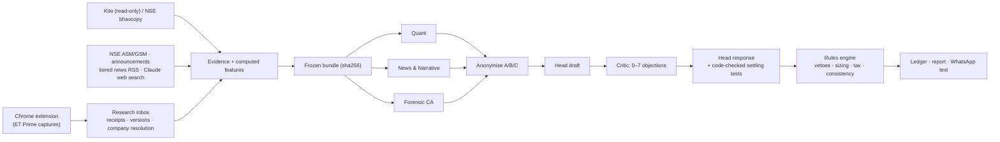

# Personal CA Platform

A local, multi-brain research panel for Indian listed equities, built from
[`Personal_CA_Platform_Final_Design_v2.md`](Personal_CA_Platform_Final_Design_v2.md).

Three specialist brains study one **frozen, hashed evidence bundle** without seeing each other's work. A **Head CA** drafts a decision, a **Critic CA** attacks it with settling tests, and **deterministic code** enforces vetoes, sizing and tax. Every claim cites a source passage, and **code checks every quote verbatim**. Every stage streams live to a progress tracker, and everything lands in a DuckDB ledger.

> Personal research only. **Analysis, not investment advice.** No order placement: Kite access is read-only by construction.



## What makes it accountable

| Mechanism | What it guarantees |
|---|---|
| **Verified-quote citations** | Every model statement cites `evidence_id` + `passage_id` + a verbatim quote. Code classifies each citation as `verified`, `id_only`, `quote_mismatch`, `unknown_passage` or `unknown_evidence`. Defects trigger a bounded repair request; citation integrity is scored per report. In the UI, click any chip to open the exact passage with the quote highlighted. |
| **Source tiers** | `T1_official` (NSE/BSE/regulators) › `T2_reputable_press` (ET, BS, Mint, BusinessLine, Reuters, Moneycontrol…) › `T3` › `T4_capture_unverified` (your browser captures) › `T5_aggregator`, plus `SYS_computed`. Search is restricted to allow-listed domains (`config/sources.yaml`). Syndicated copies are deduplicated. |
| **Search citations are the source's words** | News/filings discovery uses Claude's web search with `allowed_domains`. Passages are the API's verbatim `cited_text`, not model paraphrase. A search "page age" is shown as a hint, never promoted to a publication date. |
| **Frozen, hashed bundle** | Discovery finishes before the brains start. The bundle is canonical-JSON hashed and stored, and each role gets only its remit's slice of it. |
| **Code decides what's resolved** | If the Head rejects an objection without a verified citation, or skips one, code treats it as `unresolved`. Any open blocker prevents a buy. |
| **Rules in code** | Surveillance, liquidity, stale data, corporate-action flags, pledge, governance (code rubric), auditor, reward/risk, benchmark (after-tax, only with a verified tax policy), required evidence, and plan validity. Unknown never passes silently. |
| **Full audit trail** | Every model call is logged with role, prompt version, configured vs served model, provider request id, tokens, cost and latency, plus the full request and response. Identical requests hit the cache by complete-request hash. Each decision gets an evaluation contract frozen at issuance. |
| **Memory without hidden state** | The Head receives earlier verdicts on the same stock from the ledger, with their entry and invalidation conditions and open blockers. Specialists never see them, so they judge the evidence fresh. |

## Models per role (Anthropic + OpenAI)

**System → Models** lets you pick a provider, model and effort for every role: Quant, News, Forensic, Head, Critic and Claims. Model lists load **live** from each provider's Models API (newest first) once its key is set (`ca secrets set OPENAI_API_KEY`). Choose *Custom model id…* for anything not listed.

- Recommended: put the **Critic on a different provider than the Head**. The UI shows vendor separation as `separated`, `partial` or `degraded`, and every decision records it.
- `discovery` (web search) and `research_qa` (Citations API) stay on Anthropic, because they rely on Anthropic-specific tools.
- Your choices are saved to `data/settings/models_override.yaml` (git-ignored) and merged over `config/models.yaml`. The effective version gets a `+local-<hash>` suffix, so a run is always traceable to its exact models.
- If a model has no price in config, its calls are recorded as **cost unknown**, never guessed, and the UI asks you to add the price.
- Both providers go through the same validators, citation checks, bounded repair, caching and audit records. OpenAI uses the Responses API with strict structured outputs (`store=false`).

## Analysis loops

Choose 1–3 loops when starting a run (UI or `ca analyse TCS --loops 2`). Every extra loop:

1. **Re-fetches all evidence:** prices, NSE data, news, captures and facts.
2. **Searches for the previous loop's open questions:** unsettled Critic objections, each brain's missing evidence, and rules that came out `unknown`.
3. **Builds a new bundle** that links to its parent, and **re-runs the brains blind**.
4. **Gives the Head and Critic a `<previous_loop>` block.** They state what the new evidence settled or left open, and the Critic re-tests open objections instead of repeating settled ones.

The run page has a **tab per loop** with its own progress tracker, plus a **"What changed across loops"** table: evidence, questions searched, decisions, objections, governance coverage and citation integrity. Only the final loop issues a verdict; earlier loops are stored as loop records, so retries never inflate the track record. Cost scales with loops, and the budget reservation is multiplied accordingly.

## Newsdesk (news module)

`ca_platform/newsdesk/`, adapted from `references_news/` into the platform. It collects each stock's news, merges articles about the same event, checks press claims against filings, and ranks events. You can use it on its own from the **Newsdesk** page or with `ca news check|dossier|quality SYMBOL`. Every analysis also freezes a Newsdesk dossier into its evidence bundle.

**Filed financials** (`ca_platform/data/nse_xbrl.py`, `ca_platform/features/fundamentals.py`) read each company's results and shareholding XBRL filings from NSE and compute P/E, P/B, ROE, growth, cash conversion, pledge and (for banks) NPA, PCR and CET-1 in code, each with its formula and source filing. Check a stock on its own with `ca fundamentals SYMBOL`; every run shows them in the **Numbers** tab.

- **Sources:**
  - NSE corporate announcements, with the **filed PDF read for figures** (official tier). NSE's archive serves them to an honest client; BSE's API refuses one, so BSE isn't used.
  - Google News search, credited to the real publisher. **Only publishers in the source registry are used**; the rest are kept on record and set aside.
  - Publisher RSS feeds.
  - Your ET Prime captures.
- **Claim statuses:**
  - `filed`, `confirmed`, `contradicted`, `denied`, `filing_on_event`, `investigative` or `unconfirmed`.
  - A press figure is confirmed or contradicted only by a filed figure **of the same metric** (order value vs order value, never vs revenue).
  - Only a clarification *filing* can deny a press report.
  - Wording-alike copies from several outlets count as **one** story.
  - Statuses and scores are computed for the decision time, so dossiers are point-in-time, and unknown publication times stay unknown.
- **Who uses it:**
  - **News** brain: everything.
  - **Forensic**: filings, plus press governance, accounting, regulatory, pledge and litigation reports.
  - **Quant**: filed results, dividends and fund-raises, plus the "coming up" schedule.
  - **Head and Critic**: see the statuses in the computed "Newsdesk summary" source.
- **Background refresh:** while `ca serve` runs, watched stocks are refreshed: every 10 minutes during market and evening hours, hourly otherwise. Settings are in `config/newsdesk.yaml` (junk patterns, routine filings, PDF limits, polling). The first fetch of a stock can take a few minutes because NSE serves PDFs slowly.

## ET Prime lists → stock ideas → batch analysis

The **ET Prime & ideas** page holds two lists you can edit any time. They're saved to `data/settings/et_lists.yaml`, which you can also edit by hand.

| List | What happens |
|---|---|
| **News articles** (any number) | Each article is captured and joins future analyses of any stock it mentions, or that you link it to, as a news source. |
| **Stock-idea articles** (about 10, max 20) | Every pick is extracted with a verbatim quote: stance, target, horizon, who recommends it. Picks are ranked across articles, and you see the best 5, 8 or 10. |

Workflow:
1. Paste links into the lists and click **Save lists & queue new articles**. Only articles not yet captured are queued; **Re-capture all** picks up updated articles as new versions.
2. In the extension, click **Fetch queued articles**. Each one is read in your own signed-in Chrome.
3. Click **Extract & rank ideas**. The ranking score is *3 × articles positive (buy or accumulate) − 3 × articles negative + 1 × neutral mentions + 0.5 × named recommenders + target upside*. Upside uses the Kite MCP last price or the bhavcopy close, and is capped. Every mention shows its quote and source article.
4. Tick the stocks you want, choose horizon, loops and mode, and click **Analyse selected**. A batch runs the full panel on each stock; `ideas.batch_concurrency` sets how many run at once.
5. The **batch page** shows live progress, then a comparison sorted actionable buys → wait → hold → insufficient data → avoid. Each row links to its full report, and a combined Markdown report is written to `data/reports/`.

**More ET content:** "Find more ET articles for a stock" queues a *topic scan*. The extension opens ET's topic page for that company, collects article links (Prime pieces first, up to `inbox.scan_max_links`) and captures them in the same fetch session. The queue holds up to 100 articles, and the News brain can now read about 400k characters of evidence (`analysis.max_view_chars`).

Ideas are attributed opinions from your articles. They decide *what to look at*, never the decision: every pick still goes through all the evidence, panel and rule gates.

## Best sources

Each verdict shows a ranked **"Best sources for this decision"** list. You can show 5, 8 or 10 (default 8, set in `config/user.yaml → display.top_sources`). The score is *source tier × how often the panel relied on it (verified quotes count most) × recency*, and each entry explains its rank, e.g. "Official / exchange · cited 4× (3 verified) by forensic, head · 12 days old". Computed prices and technicals are excluded from the ranking. Every source remains in the Sources tab.

## Quick start (Windows / macOS / Linux, Python 3.11+)

```bash
python -m venv .venv
.venv\Scripts\activate            # macOS/Linux: source .venv/bin/activate
pip install -e ".[dev]"

ca analyse --mode demo            # full pipeline on a FICTIONAL company, no keys, $0
ca serve                          # UI at http://127.0.0.1:8765
```

For live analysis:

```bash
ca secrets set ANTHROPIC_API_KEY   # stored in the OS keychain
ca equity-master                   # NSE symbol/ISIN list for company resolution
ca ingest-bhav --days 260          # ~5 min once; end-of-day prices if Kite isn't connected
ca analyse TCS --horizon medium
```

Then review `config/` (horizons, rules, capital, tax). Everything stays **research-only** until you set
`policies_confirmed: true` in `config/user.yaml`, and after-tax figures are refused until you verify
`config/tax_rates.yaml`. This is deliberate (spec §15 step 7).

### Financial facts

NSE XBRL ingestion is not built yet. Until it is, copy key figures from the official filing into
`data/manual/<SYMBOL>.yaml` (see [`docs/examples/manual_facts.example.yaml`](docs/examples/manual_facts.example.yaml)).
Without it, Forensic coverage is low: the governance score is withheld and buys stay blocked. The system says this rather than guessing.

## The UI

- **Analyse:** pick a symbol, horizon, action and Live/Demo mode.
- **Run view:** a five-phase progress tracker with a card per stage. The three brains run as parallel lanes and stream sub-steps live: views prepared, model calls, tokens, cost, citation scores and repair attempts.
- **Verdict:** the decision flow (*Head draft → after critique → after rules*), cited reasons, and the checklist of exactly what stands between the result and an actionable decision, with a fix hint for each item.
- **Tabs:**
  - *Overview & chart:* candlesticks, SMAs and plan levels.
  - *Analyst reports:* findings, checks and citation integrity.
  - *Head ↔ Critic:* objections, responses and code-judged results.
  - *Rules*
  - *Sources:* filter by tier; every passage.
  - *Audit trail:* model calls, hashes, versions and WhatsApp text.
- **Research inbox:** captures from the extension, extracting claims as attributed and unverified, with verification tasks. Research-only Q&A with passage-level citations (Citations API).
- **Portfolio:** Kite login and read-only holdings, with a one-click "Review holding".
- **System:** a readiness checklist, the extension pairing token and config reload.

## Chrome extension (ET Prime capture)

`browser/chrome-extension/` is a Manifest V3 extension, v0.5.0, with a side panel and a background worker. It ships with this repo. It is **not** the older "Personal CA Research Companion 0.1.1" prototype; disable that one.

**Set up once**
1. `chrome://extensions` → Developer mode → **Load unpacked** → select `browser/chrome-extension`. After a `git pull`, click the extension's reload ↻ icon.
2. In Personal CA → **System**, copy the pairing token. In the extension → **Settings**, paste it, then click **Save & test**.
3. Tick the personal-research attestation, click **Allow ET access** (grants `economictimes.indiatimes.com` only), and leave **Auto-fetch** on.
4. The ET Prime page turns green: **"Extension v0.5.0 connected"**. The extension checks in every minute, and with Auto-fetch on it captures newly queued articles in background tabs of your own Chrome, with no clicks needed. **Fetch now** on the ET page, or in the side panel, starts a fetch immediately.

**Queue several ET articles: the main workflow**
1. In Personal CA → **Research inbox → ET Prime article queue**, paste ET links, one per line. Optionally tag a stock, e.g. `TCS`. From the extension you can also use **Add this tab**, or open an ET listing or topic page and use **Scan page for articles** to tick links to queue.
2. In the extension, click **Fetch queued articles**. Each link opens in a background tab of *your* signed-in Chrome. After it renders, the extension captures the text, closes the tab and sends it with the queue id. Pages load one at a time with pacing, and you can **Stop** at any point. It **stops at a login or challenge page** rather than trying to get past it.
3. The server versions and deduplicates each article and links it to the tagged stock (or to companies it finds by name). If an API key is available, it also extracts **attributed claims with verification tasks** in the background.
4. The next analysis of that stock joins the article as a news source (tier: user capture, unverified). Its passages can be quoted and verified like any other source.

**Single article:** open it, then **Capture page** (or select text and **Capture selection**), inspect the passages, then **Send**.

The extension reads rendered, visible text only. It does not read cookies, hidden JSON or paywalled content, and does not bypass any access control. There is no server-side login or scraping. Captures are kept in session storage. **Export JSON** with `ca import-captures` is the fallback. On a source page in the inbox you can also link it to a stock manually when name matching was ambiguous.

## Kite

- **Kite MCP (recommended, free):** on the Portfolio page, click **Connect Kite (MCP)**. The platform acts as an MCP client of Zerodha's hosted server (`https://mcp.kite.trade/mcp`), using the standard MCP OAuth flow: dynamic client registration, then authorization code with PKCE. You log in on Zerodha's page, and the token stays on your laptop, in the OS keychain or else `data/secrets/`. This connection provides holdings, LTP/quotes and daily candles. Only read tools in an allowlist can be called; order, GTT and MF-order tools are refused in code, and tests enforce this. Tool arguments are matched against each tool's live schema, so a renamed parameter fails loudly.
- **Kite Connect (optional, paid data):** create a Kite Connect app with redirect `http://127.0.0.1:8765/kite/callback`, run `ca secrets set KITE_API_KEY` and `ca secrets set KITE_API_SECRET`, then log in from the Portfolio page. The adapter is read-only by construction.
- **Price source order** in analyses: Kite Connect → Kite MCP → NSE bhavcopy.
- **Chat (Claude Code):** `.mcp.json` connects the same hosted Kite MCP for chat, and `.claude/settings.json` denies every order tool there.

## Layout

```
ca_platform/   contracts · settings · ledger · events · gateway (LLM) · mock (demo)
               citations · prompting (role views) · panel (brains/head/critic) · orchestrator
               evidence · inbox · outputs · service (FastAPI) · cli
  data/        kite (read-only) · bhav · nse · news · manual · demo · sources
  features/    technicals · patterns
  rules/       engine (preflight, vetoes, governance rubric, sizing, tax, consistency)
prompts/       _shared, quant, news, forensic, head, critic, discovery, claims, research_qa (semver, front matter)
config/        models · rules · user · horizons · tax_rates · sources
web/           index.html · app.css · app.js     (no build step)
browser/       chrome-extension/
skill/         india-stock-analyst/SKILL.md
tests/         features · citations/panel · rules invariants · security/intake · demo pipeline
docs/          DESIGN_NOTES.md (status vs spec, open concerns) · examples/
```

## Tests

```bash
pytest -q
```

Covers deterministic features, the double-bottom detector, citation verification, code-side objection resolution, allocation invariants (caps, the 2% planned loss, tranches above stop, the floor, the tight-stop guard), veto behaviour, read-only Kite, intake idempotency and versioning, loopback/token/origin security, and an end-to-end demo run through all 17 stages.

See [`docs/DESIGN_NOTES.md`](docs/DESIGN_NOTES.md) for what is implemented versus the spec, and for the open concerns.
